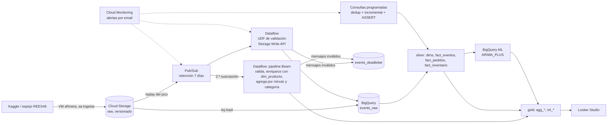

# Plataforma eCommerce en GCP — REES46 + Olist

**Grupo 1 · Big Data · UTEC Posgrado.** Implementación en Google Cloud del diseño del examen
(`Examen-grupo-1.pdf`): ingesta batch y streaming de eventos de una tienda online, integración con pedidos y
entregas de otra tienda, tableros en Looker Studio y pronóstico de demanda con BigQuery ML.

- **Proyecto GCP:** `bigdata-g1-ecommerce-1105` · región `us-central1` · datos en multirregión `US`.
- **Datos:**
  - REES46 *multi category store*: eventos de navegación y compra, oct 2019 – abr 2020 (410 M eventos; el dataset público termina en abril). Octubre y noviembre vienen de Kaggle; diciembre a abril, del espejo del autor.
  - Olist: pedidos y entregas en Brasil, 2016–2018.
- **Entrega P2 (7 nov 2026):** versión congelada en el tag
  [`p2-entrega`](https://github.com/RVargasC22/bigdata-g1-ecommerce-gcp/tree/p2-entrega); la guía por criterio
  de la rúbrica está en [`docs/entrega_p2.md`](docs/entrega_p2.md).

## Arquitectura



Transversal:
- **Identidades y secretos:** una cuenta de servicio por componente; el token de Kaggle vive en Secret Manager.
- **Gobierno:** glosario y linaje en Dataplex; capas `bronze` / `silver` / `gold` con etiquetas.
- **Acceso fino:** policy tags sobre los identificadores de personas y row access policies.
- **Infraestructura como código:** Terraform y CI en GitHub Actions.

## Resultados principales

| Tema | Resultado |
|---|---|
| Pico de tráfico | El pico real es el 15–17 nov 2019 (factor 5,5 el 17/11), no Black Friday (1,6) ni Cyber Monday (1,4). |
| Streaming | 3 replays (17/11 a 10x; Black Friday y Cyber Monday a 60x): 9 990 850 mensajes publicados y ninguno perdido. Dataflow escala de 1 a 2 workers, con lag máximo de 7 s. |
| Transformación en tiempo real | Pipeline Apache Beam propio en Dataflow (`streaming/beam/`): valida, enriquece cada evento con la categoría del producto y agrega por minuto y categoría en `stream_categoria_minuto`. Replay a 10x de 17/11 10:30–11:00: 227 830 eventos, 379 de 379 combinaciones minuto × categoría idénticas al cálculo batch (eventos, compras e ingresos al centavo); los 3 mensajes inválidos de prueba van a la cola de errores. Con 1 worker y a 10x, cada minuto queda escrito 3–4 min después de cerrar su ventana (p50 189 s). |
| Deduplicación | Se eliminaron 21 696 eventos repetidos: duplicados del CSV de origen y reentregas de Pub/Sub. |
| Calidad | El archivo de diciembre trae una taxonomía distinta (76 % de las compras con categoría contradictoria). Se corrigió por producto y quedó un control automático que lo detecta. |
| Costo | La demostración (carga oct–dic y 3 replays) costó unos US$4,35, aprox. US$0,0018 por cada 1 000 pedidos. Todo el proyecto a la fecha, con desarrollo, la carga de 2020 y el pronóstico, factura 0,75 TiB en consultas (~US$4,7 a precio de lista, gratis dentro del TiB mensual) más ~US$1,8 de Dataflow y VMs; el entrenamiento de XGBoost (50,8 GB, otra tarifa) está pendiente de confirmar en el reporte de facturación. El almacenamiento (103 GB lógicos en BigQuery y 19,6 GB en Cloud Storage) cuesta ~US$2,2 al mes. |
| Pronóstico | ARIMA_PLUS por categoría, entrenado con 2019 y validado contra ene–abr 2020 reales: error de 36 % en ene–feb contra 20 % de un promedio simple (abril: 39 % contra 21 %). Con tres meses de historia no supera la referencia; el intervalo de 90 % cubre el 93,5 % de los días de ene–feb (94 % en ene–abr). En Olist, con 17 meses de historia, tampoco ganan ARIMA ni TimesFM; XGBoost queda cerca del promedio en jun–jul (32 % contra 31 %) y lo supera en agosto (24 % contra 28 %). Ver `docs/correcciones_documento.md`, sección 6. |

## Estructura

```
infra/        setup del proyecto, IAM, VM de ingesta, consultas programadas, gobierno, acceso fino
ingest/       descarga a GCS (Kaggle + espejo REES46) y carga batch a BigQuery
streaming/    productor de replay (Pub/Sub), lanzamiento y drenado de Dataflow, UDF de validación;
              beam/: pipeline Apache Beam propio (limpieza, enriquecimiento y agregación en tiempo real)
sql/          capas raw -> silver -> gold, calidad, gobierno, refresco incremental, pronóstico (BigQuery ML)
monitoring/   alertas de Cloud Monitoring y export de métricas del pico
drp/          snapshots y simulacro de recuperación
terraform/    infraestructura como código (adopta los recursos existentes con bloques import)
seed/         mapeo manual de categorías REES46 / Olist -> categoría común
docs/         correcciones al documento del examen, entrega P2 (entrega_p2.md) y evidencia de las pruebas
```

## Requisitos

- `gcloud` y `bq` autenticados como owner del proyecto.
- Python 3. Para el pipeline Beam: Python 3.12 con `apache-beam[gcp]==2.66.0` (ver `streaming/beam/launch.sh`).
- Terraform ≥ 1.7.
- Un token de Kaggle en `~/.kaggle/access_token`, solo para crear el secreto la primera vez.

## Configuración

Las cuentas personales y los IDs reales no se versionan:

```bash
cp config.env.example config.env                                   # proyecto, bucket, cuentas, facturación
cp terraform/terraform.tfvars.example terraform/terraform.tfvars
```

Todos los scripts leen `config.env`. `sql/run.sh` aplica un tope de bytes facturados a cada consulta y completa
los placeholders `${OWNER_ACCOUNT}`, `${ANALYST_ACCOUNT}`, etc. de `sql/12_row_access.sql`. Por eso los SQL se
corren siempre con `sql/run.sh`.

## Ejecución

Orden para montar todo desde cero:

```bash
./infra/01_setup.sh                       # bucket, datasets, Pub/Sub, presupuesto
./infra/02_iam.sh                         # cuentas de servicio por componente + token de Kaggle en Secret Manager
./monitoring/setup_alerts.sh              # alertas: system lag, backlog Pub/Sub, scheduled query fallida
./infra/03_vm.sh                          # VM temporal de ingesta (sa-ingesta; lee el token del secreto)
gcloud compute ssh ingest-vm --zone=us-central1-a --tunnel-through-iap -- 'bash ~/app/ingest/download_to_gcs.sh'
./ingest/bq_load.sh                       # batch: bq load + dedup + Olist + dims + facts + agregados
python3 infra/04_fine_grained_access.py   # policy tags sobre user_id y customer_unique_id
sql/run.sh sql/12_row_access.sql          # row access policies en fact_pedidos
./infra/05_governance.sh                  # Dataplex: linaje + glosario (capas y descripciones: sql/11_governance.sql)
./infra/06_scheduled_queries.sh           # 06:00 dedup + refresco incremental (sql/14); 07:00 chequeos ASSERT (sql/15)
sql/run.sh sql/16_forecast.sql            # pronóstico ARIMA_PLUS por categoría + validación con ene–abr 2020
sql/run.sh sql/18_forecast_olist.sql      # experimento Olist: ARIMA 17 y 3 meses, XGBoost, TimesFM y promedio
```

Desde el 6 nov 2026 las dos consultas programadas están en pausa, porque los datos ya no cambian. Para
reactivarlas: `bq update --transfer_config --no_auto_scheduling=false <nombre de la configuración>` (los nombres
salen de `bq ls --transfer_config --transfer_location=us`).

Los scripts de IAM los corre el owner del proyecto. Para agregar ene–abr 2020 a una carga existente:
`ingest/fetch_2020.sh [meses]`, que usa una VM que se borra sola, y luego `sql/17_load_2020.sql`.

### Streaming: replay del pico

```bash
./streaming/launch_dataflow.sh      # esperar ~3 min a que el job esté Running
gcloud compute ssh ingest-vm --zone=us-central1-a --tunnel-through-iap -- \
  'nohup bash ~/app/streaming/run_replays.sh > ~/replays.log 2>&1 &'   # 17/11 a 10x, 29/11 y 02/12 a 60x
gcloud compute ssh ingest-vm --zone=us-central1-a --tunnel-through-iap -- \
  'source ~/app/config.env && ~/venv/bin/python ~/app/monitoring/export_metrics.py --project $PROJECT_ID --hours 4'
./streaming/stop_dataflow.sh        # drain: termina lo pendiente sin perder mensajes
./infra/99_teardown.sh              # apaga lo que cobra por hora (VM y Dataflow)
```

### Streaming: pipeline Beam (limpieza, enriquecimiento y agregación)

```bash
sql/run.sh sql/19_stream_aggregates.sql   # tabla gold stream_categoria_minuto + función conciliar_stream
./streaming/beam/launch.sh                # exporta el lookup producto -> categoría a GCS y lanza el job
./streaming/beam/test_replay.sh "2019-11-17 10:30:00" "2019-11-17 11:00:00"   # VM: tramo a 10x + 3 mensajes inválidos
bq query --use_legacy_sql=false "SELECT * FROM ecommerce.conciliar_stream('2019-11-17 10:30:00', '2019-11-17 11:00:00') WHERE NOT coincide"
./streaming/stop_dataflow.sh
```

El job lee su propia suscripción (`rees46-events-beam`), así que convive con el job de la plantilla: cada mensaje
llega a los dos. Las ventanas son por hora de llegada (marca de Pub/Sub) y la clave lleva el minuto del evento,
por lo que un replay de 2019 también cuadra con el batch. Con ventanas por hora del evento, el watermark descarta
como tardíos los eventos de 2019. Test local: `cd streaming/beam && python -m pytest test_pipeline.py`, que también corre en CI.

### Evidencia

```bash
sql/run.sh sql/07_peak.sql sql/10_quality.sql sql/08_cost_per_order.sql
sql/09_bytes_scanned.sh
./drp/snapshot.sh && ./drp/recovery_drill.sh
```

Los resultados de cada prueba están en `docs/evidencia/` y su lectura en `docs/correcciones_documento.md`.

## Mapa documento → código

| Sección del documento | Archivos |
|---|---|
| 1. Stack y capas raw / curated / analytics | `infra/01_setup.sh`, `sql/01_ddl.sql`, `sql/05_analytics.sql` |
| 2. Escalabilidad y pico | `streaming/producer.py`, `streaming/run_replays.sh`, `streaming/launch_dataflow.sh`, `sql/07_peak.sql`, `monitoring/export_metrics.py` |
| 3. Costos y optimización | `sql/08_cost_per_order.sql`, `sql/09_bytes_scanned.sh`, `infra/lifecycle.json`, presupuesto en `infra/01_setup.sh` |
| 4. DRP / HA | `drp/snapshot.sh`, `drp/recovery_drill.sh`, `streaming/stop_dataflow.sh`, `monitoring/alert_*.json` |
| 5. Integración multifuente | `seed/dim_categoria.csv`, `sql/03_dims.sql`, `sql/04_facts.sql`, `sql/06_fact_inventory.sql`, `sql/10_quality.sql` |
| Procesamiento en tiempo real (Beam): limpieza, enriquecimiento, agregación | `streaming/beam/pipeline.py`, `streaming/beam/test_pipeline.py`, `streaming/beam/launch.sh`, `streaming/beam/test_replay.sh`, `sql/19_stream_aggregates.sql` |
| 7. Ingesta y storage | `ingest/download_to_gcs.sh`, `ingest/bq_load.sh`, `streaming/udf/transform.js`, `ingest/fetch_2020.sh`, `sql/17_load_2020.sql` |
| Seguridad: IAM y secretos | `infra/02_iam.sh` |
| Gobierno: capas, glosario, linaje | `infra/05_governance.sh`, `sql/11_governance.sql` |
| Acceso fino: columnas y filas | `infra/04_fine_grained_access.py`, `sql/12_row_access.sql` |
| Cola de errores (dead-letter) | `streaming/launch_dataflow.sh` (`events_deadletter`), `streaming/udf/transform.js`, `sql/13_quality_dashboard.sql` |
| Operación: dedup, refresco incremental, chequeos | `sql/14_incremental.sql`, `sql/15_checks.sql`, `infra/06_scheduled_queries.sh` |
| Alertas | `monitoring/setup_alerts.sh`, `monitoring/alert_*.json` |
| Pronóstico de demanda (BigQuery ML) | `sql/16_forecast.sql`, `sql/18_forecast_olist.sql` |
| Infraestructura como código y CI | `terraform/`, `.github/workflows/ci.yml` |

## Decisiones de implementación

- **Días en streaming.** El 17/11, el 29/11 y el 02/12/2019 se excluyen de la carga batch. Entran solo por Pub/Sub → Dataflow, así no se duplican. `events_raw.source` distingue `batch` y `stream`.
- **Validación.** La UDF de Dataflow (`transform.js`) rechaza `event_type` desconocidos, fechas mal formadas, precios inválidos e IDs no numéricos. Esos mensajes van a `events_deadletter` sin detener el flujo.
- **Duplicados.**
  - Batch: pasa por `events_staging` (todo STRING) y se inserta con `SELECT DISTINCT`.
  - Streaming: Pub/Sub entrega al menos una vez, así que la consulta diaria (`sql/14`) deja una sola copia de cada evento idéntico.
  - Dataflow escribe con la Storage Write API, que permite ese `DELETE` de inmediato.
- **Refresco incremental.** La consulta diaria procesa solo las particiones modificadas en las últimas 26 h (metadatos gratuitos), con `DELETE` + `INSERT`. El DML conserva descripciones, etiquetas y row access policies.
- **Taxonomía desde diciembre.**
  - Los archivos del espejo (dic 2019 – abr 2020) numeran `category_id` / `category_code` distinto que Kaggle. Ejemplo: smartphones Samsung como `construction.tools.light`.
  - La categoría se toma por producto desde oct–nov (`dim_producto`) y `fact_eventos` la usa en lugar del código del evento.
  - Los productos nuevos desde diciembre se clasifican con un puente: cada `category_id` nuevo toma la categoría de oct–nov de la mayoría de sus productos compartidos (al menos 5 y 80 % de acuerdo).
  - `sql/15_checks.sql` falla si una categoría salta más de 4x en una semana.
- **Inventario derivado (supuesto).** Stock fijo de 50 unidades por producto cada lunes; cada `purchase` resta una unidad. `quiebre = true` cuando la demanda de la semana alcanza el stock.
- **Pronóstico.** ARIMA_PLUS con una serie diaria de compras por categoría. Se entrena solo con 2019 y se compara contra ene–abr 2020 reales, que el modelo nunca vio. Marzo y abril incluyen el confinamiento por COVID-19 en Rusia.
  - Cada error se compara con una referencia ingenua: el promedio oct–dic 2019 de cada categoría. Con tres meses de historia ARIMA no la supera; se necesita al menos un año.
  - Los días en que el origen dejó de registrar compras (14–15 nov 2019, 1–2 ene y 20–21 abr 2020) se excluyen del entrenamiento y de la evaluación (`v_dias_compras_incompletas`).
  - Control con Olist (`sql/18_forecast_olist.sql`): 17 meses de historia, cinco métodos sobre jun–ago 2018. Más historia no ayuda a ARIMA y TimesFM; XGBoost con variables de nivel y día de semana empata con el promedio.
- **Zonas horarias.** REES46 ya viene en UTC; Olist se convierte de `America/Sao_Paulo` a UTC.
- **Tableros.** Looker Studio lee solo tablas `agg_*`, `ml_*` y la vista materializada `mv_eventos_hora`, nunca `events_raw`.
- **Infraestructura como código.**
  - `terraform/` adopta con bloques `import` los recursos que crearon los scripts. `terraform plan`: 49 importados, 0 creados, 0 destruidos (`docs/evidencia/terraform_plan.txt`). El `apply` queda manual.
  - Quedan fuera, a propósito: las tablas (las crea la capa SQL), el job de Dataflow y la VM (efímeros), el valor del secreto, el presupuesto y el glosario.
- **CI.** `.github/workflows/ci.yml` valida en cada push: `terraform fmt` / `validate`, sintaxis de shell (`shellcheck`), Python, JSON, y la UDF con un evento válido y otro inválido. En `main`, una vez configurado Workload Identity Federation, también corre `terraform plan` y un dry run del SQL.

## Looker Studio

Reporte (acceso restringido al equipo):
https://lookerstudio.google.com/reporting/270afb19-8307-4db9-b5a8-4465d24330ee

Tiene 7 páginas:
1. Pedidos e ingresos
2. Embudo por categoría
3. Demanda vs stock
4. Entregas y conversión
5. Streaming en vivo
6. Calidad y gobierno
7. Pronóstico de demanda

Fuentes: tablas `agg_*` y `ml_*` del dataset `ecommerce`, y `mv_eventos_hora`. Las fuentes guardan caché de
12 h: antes de presentar, ⋮ → Actualizar datos.

Para recrearlo, abre `docs/looker_crear_reporte.url` (Linking API): crea el reporte con `agg_pedidos_hora` ya
conectada. Las demás fuentes se agregan con "Agregar datos".

## Runbook DRP

| Escenario | Acción |
|---|---|
| Worker de Dataflow cae | Automático (Dataflow lo reemplaza). |
| Job de Dataflow cae | Alerta de system lag o de backlog Pub/Sub → `streaming/launch_dataflow.sh`; Pub/Sub retiene 7 días. |
| Tabla borrada | `bq cp ecommerce.TABLA@<epoch_ms> ecommerce.TABLA` (time travel 7 días) o `bq cp --restore ecommerce_dr.<snapshot> ecommerce.TABLA`. |
| Datos erróneos | `bq cp --force ecommerce.TABLA@<epoch_ms> ecommerce.TABLA` (conserva partición y clustering), o recargar desde `gs://…/raw`, que nunca se modifica. |
| Refresco diario o chequeo falla | Alerta por email (scheduled query fallida); el mensaje del `ASSERT` indica qué control falló. |
| Falla regional | `streaming/stop_dataflow.sh` y `streaming/launch_dataflow.sh us-east1`; bucket y dataset son multirregión. |
