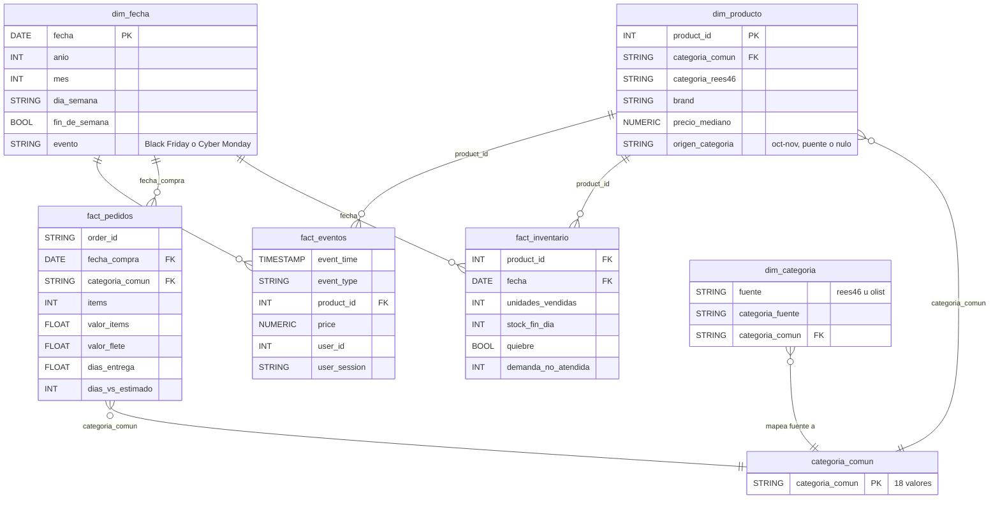

# Entrega P2: procesamiento, transformación y modelado

**Grupo 1 · Big Data · UTEC Posgrado.** Proyecto GCP `bigdata-g1-ecommerce-1105`. Este documento ubica cada
criterio de la rúbrica en el código del repositorio y en la evidencia de su ejecución. Todo lo descrito está
desplegado y fue corrido sobre los datos reales: REES46, 410 M eventos de oct 2019 a abr 2020, y Olist, 99 470
pedidos de 2016 a 2018.

| Criterio | Dónde está | Evidencia |
|---|---|---|
| Pipelines de cómputo y transformación: limpieza, enriquecimiento y cruce de datos heterogéneos | SQL en BigQuery (`sql/02` a `sql/06`, `sql/14`, `sql/17`) y Apache Beam en Dataflow (`streaming/beam/pipeline.py`) | `docs/correcciones_documento.md` (secciones 5 y 6), `docs/evidencia/sql_post_replay.txt` |
| Procesamiento híbrido: tiempo real y lotes | Tiempo real: Pub/Sub → Dataflow (plantilla con UDF y pipeline Beam propio). Lotes: `bq load` + SQL y una consulta programada incremental diaria | `docs/evidencia/replays.log`, `docs/evidencia/metricas_pico.csv`, `docs/evidencia/beam_conciliacion.txt` |
| Modelado para analítica: estructuras finales listas para su consumo | Capas bronze, silver y gold; esquema en constelación con dimensiones compartidas (`sql/03`, `sql/04`, `sql/05`, `sql/19`) | Looker Studio (7 páginas) lee solo tablas gold; `sql/09_bytes_scanned.sh` |

## 1. Pipelines de transformación

### Limpieza

| Paso | Código | Resultado medido |
|---|---|---|
| Tipado y descarte de filas inválidas en la carga batch (todo llega como STRING a `events_staging`) | `sql/02_load_events.sql`, `sql/17_load_2020.sql` | 221 166 filas duplicadas o inválidas eliminadas en oct–dic 2019 |
| Validación de cada mensaje en tiempo real: formato de fecha, tipo de evento, `product_id` entero, precio no negativo | `streaming/udf/transform.js` (plantilla) y `parse_event` en `streaming/beam/pipeline.py` | Los inválidos van a `events_deadletter` con su motivo, sin detener el flujo: 3 de 3 mensajes de prueba en cada job |
| Deduplicación del streaming (Pub/Sub entrega al menos una vez) | `sql/14_incremental.sql` (consulta programada 06:00) | 21 696 filas repetidas eliminadas |
| Días con el registro de compras caído en el origen | Vista `v_dias_compras_incompletas` en `sql/16_forecast.sql` | Detecta sola 14–15 nov 2019, 1–2 ene y 20–21 abr 2020 |
| Chequeos diarios con ASSERT | `sql/15_checks.sql` (07:00) | Claves nulas, duplicados, agregados que no cuadran con la capa raw, saltos de más de 4x |

### Enriquecimiento

- **Categoría estable por producto** (`sql/03_dims.sql`). Desde diciembre de 2019 el origen cambió la numeración
  de `category_id`: el 76 % de las compras de diciembre traía una categoría que contradice la del producto en
  oct–nov. `dim_producto` fija una categoría por producto. Los productos nuevos la heredan de un puente: cada
  `category_id` nuevo toma la categoría de la mayoría de sus productos compartidos, con al menos 5 productos y
  80 % de acuerdo (acuerdo medio medido: 94 %).
- **Categoría común entre fuentes** (`seed/dim_categoria.csv` → `dim_categoria`). Mapea las categorías de REES46
  y de Olist a 18 categorías comunes (13 aparecen en REES46); es la clave que permite cruzar las dos tiendas.
- **En tiempo real** (`streaming/beam/pipeline.py`). Cada evento se enriquece dentro del stream con la
  categoría común de su producto, usando como side input el mapeo exportado de `dim_producto` (386 299
  productos).
- **Tiempo y logística** (`sql/04_facts.sql`). Olist registra la hora de São Paulo y se convierte a UTC. Se
  calculan días a despacho, días de entrega y atraso contra la fecha estimada, y se toma el medio de pago
  principal de cada pedido.
- **Inventario derivado** (`sql/06_fact_inventory.sql`). REES46 no trae stock. Supuesto explícito: cada producto
  empieza la semana con 50 unidades, cada compra descuenta una y el lunes se repone. De ahí salen los quiebres de
  stock y la demanda no atendida.

### Cruce de fuentes heterogéneas

Las fuentes son eventos de clic en CSV y en mensajes JSON (REES46), pedidos relacionales en 9 tablas (Olist) y
un inventario derivado. Se cruzan en `sql/05_analytics.sql`:

| Cruce | Tabla gold | Une por |
|---|---|---|
| Demanda vs. inventario derivado | `agg_demanda_vs_inventario` | Producto y día |
| Conversión de REES46 vs. cumplimiento de Olist | `agg_conversion_vs_cumplimiento` | Categoría común |
| Patrón hora × día de semana de ambas tiendas | `agg_patron_horario` | Hora y día de semana |

Límite: Olist (Brasil, 2016–2018) y REES46 (2019–2020) no comparten tienda ni periodo. El cruce es por
categoría y patrón horario: sirve para demostrar la integración, no para sacar conclusiones de negocio.

## 2. Procesamiento híbrido

| | Tiempo real | Lotes |
|---|---|---|
| Entrada | Pub/Sub `rees46-events`, con una suscripción por consumidor | Cloud Storage (CSV y CSV.gz) |
| Motor | Dataflow: plantilla Pub/Sub → BigQuery con UDF, y pipeline Apache Beam propio | BigQuery SQL: `bq load` y consultas programadas |
| Transformaciones | Validación y cola de errores (ambos jobs); enriquecimiento y agregación por minuto (Beam) | Tipado, deduplicación, dimensiones, hechos, agregados, inventario |
| Destino | `events_raw` (bronze) y `stream_categoria_minuto` (gold) | silver y gold |
| Frecuencia y latencia | Continua. Plantilla: retraso máximo de 7 s a 60x. Beam: cada minuto queda escrito 3–4 min después de cerrar su ventana, con 1 worker a 10x (p50 189 s) | Carga inicial única; refresco incremental diario a las 06:00 que solo procesa las particiones modificadas en 26 h |

**Pipeline Beam** (`streaming/beam/pipeline.py`):

```
Pub/Sub (rees46-events-beam)
  → Validar          (inválidos → events_deadletter)
  → Enriquecer       (side input: producto → categoría común, desde dim_producto)
  → VentanaMinuto    (ventanas fijas de 1 min por hora de llegada; tardíos aceptados 10 min)
  → PorMinutoYCategoria → Contar (vistas, carritos, remociones, compras, ingresos)
  → stream_categoria_minuto (BigQuery, gold)
```

**Prueba de punta a punta.** `streaming/beam/test_replay.sh` reproduce desde una VM, a 10x, el tramo 10:30–11:00
del 17/11/2019, el día pico real. `ecommerce.conciliar_stream` compara el resultado con el mismo agregado
calculado en batch sobre `fact_eventos`:

| Indicador | Stream | Batch |
|---|---|---|
| Combinaciones minuto × categoría | 379 | 379 (todas coinciden) |
| Eventos | 227 830 | 227 830 |
| Compras | 7 134 | 7 134 |
| Ingresos | 2 324 635,61 | 2 324 635,61 |

El test unitario (`streaming/beam/test_pipeline.py`, DirectRunner) cubre validación, enriquecimiento, producto
desconocido y cola de errores, y corre en cada push en GitHub Actions.

**Replays del pico con la plantilla:** 17/11 a 10x, y Black Friday y Cyber Monday a 60x (unos 1 250 eventos/s).
Se enviaron 9 990 850 mensajes, sin fallos de publicación, y llegaron todos a `events_raw`. Dataflow escaló de 1
a 2 workers.

## 3. Modelado para analítica

### Capas

| Capa | Tablas | Rol |
|---|---|---|
| bronze | `events_raw` (410 M filas, particionada por día y con clustering por `event_type` y `category_code`), `events_deadletter`, `olist_*` | Datos tal como llegan, tipados |
| silver | `dim_fecha`, `dim_categoria`, `dim_producto`, `fact_eventos`, `fact_pedidos`, `fact_inventario` | Modelo integrado |
| gold | `agg_*` (8 tablas de KB), `mv_eventos_hora`, `stream_categoria_minuto`, `ml_*` | Listas para su consumo en Looker Studio y en el pronóstico |

Cada tabla lleva las etiquetas `capa` y `fuente` y descripciones por columna (`sql/11_governance.sql`).
Dataplex las cataloga junto al glosario y al linaje.

### Esquema

Es un esquema en constelación: tres tablas de hechos comparten las dimensiones de fecha y de categoría común.
La categoría está en copo de nieve: el evento llega a ella a través del producto.



| Tabla | Grano | Filas | Partición / clustering |
|---|---|---|---|
| `fact_eventos` | Un evento (vista sobre `events_raw`, sin copia) | 410 M | Hereda la partición diaria de `events_raw` |
| `fact_pedidos` | Pedido × categoría (Olist) | 99 470 | Mes de compra / `categoria_comun` |
| `fact_inventario` | Producto × día | 1,53 M | Día / `product_id` |
| `dim_producto` | Producto | 386 299 | — / `product_id` |
| `dim_fecha` | Día (sep 2016 – abr 2020) | 1 338 | — |
| `dim_categoria` | Categoría de origen → categoría común | 85 | — |
| `stream_categoria_minuto` | Minuto del evento × categoría, por ventana de llegada | En tiempo real | Día / `categoria_comun` |

### Listo para su consumo

- **Tableros.** Looker Studio (7 páginas) lee solo tablas gold de KB. Respuesta de 0,17 a 0,25 s sin caché, y
  ninguna consulta del tablero toca `events_raw`.
- **Costo de consulta.** La misma pregunta sobre `events_raw` escanea 52 668 MB con `SELECT *` y 9,6 MB
  filtrando un día de la partición; sobre la tabla agregada escanea 0,2 MB (`sql/09_bytes_scanned.sh`).
- **Pronóstico.** BigQuery ML (`sql/16`, `sql/18`) se entrena directamente sobre la tabla gold
  `agg_embudo_categoria_dia`.

## Cómo reproducir

El orden completo está en `README.md`, sección Ejecución. Para lo propio de esta entrega:

```bash
./ingest/bq_load.sh                                 # lotes: carga, limpieza, dims, hechos y agregados
sql/run.sh sql/19_stream_aggregates.sql             # tabla gold del stream + conciliar_stream
./streaming/beam/launch.sh                          # pipeline Beam en Dataflow
./streaming/beam/test_replay.sh "2019-11-17 10:30:00" "2019-11-17 11:00:00"
bq query --use_legacy_sql=false \
  "SELECT * FROM ecommerce.conciliar_stream('2019-11-17 10:30:00', '2019-11-17 11:00:00') WHERE NOT coincide"
./streaming/stop_dataflow.sh
```

## Limitaciones conocidas

- **Latencia del pipeline Beam:** 3–4 min desde el cierre de cada ventana, medida a 10x con 1 worker
  `n1-standard-2`. No se probó con más workers ni al ritmo real (~20 eventos/s).
- **Ventanas por hora de llegada.** Las ventanas usan la hora de publicación en Pub/Sub y la clave lleva el minuto
  del evento. Con eventos en vivo ambos coinciden. Con ventanas por hora del evento, un replay de datos de 2019
  queda años atrás del watermark de Dataflow y se descarta como tardío.
- **Inventario derivado:** sale de un supuesto (50 unidades por producto y semana), no de datos reales.
- **REES46 y Olist** no comparten tienda ni periodo (ver Cruce de fuentes).
