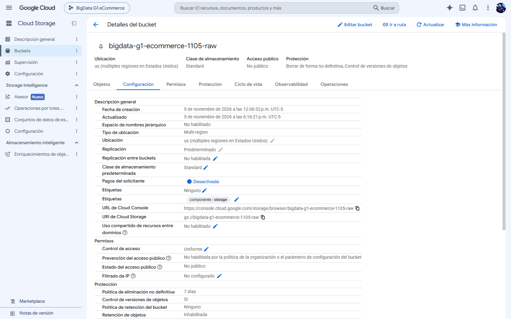
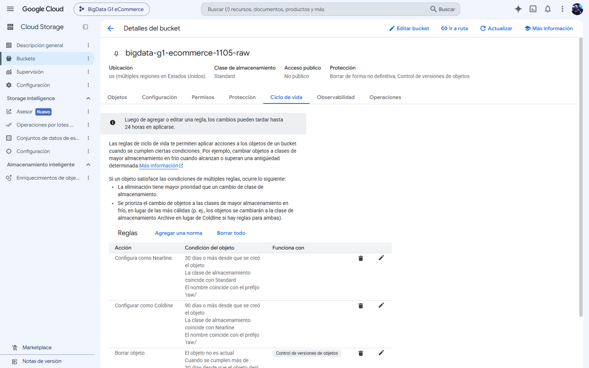
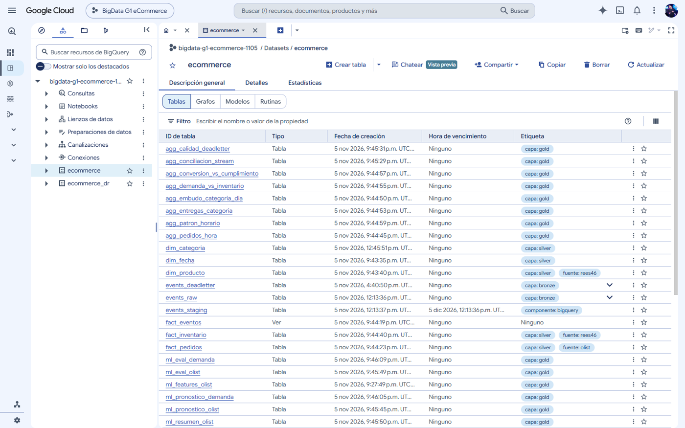
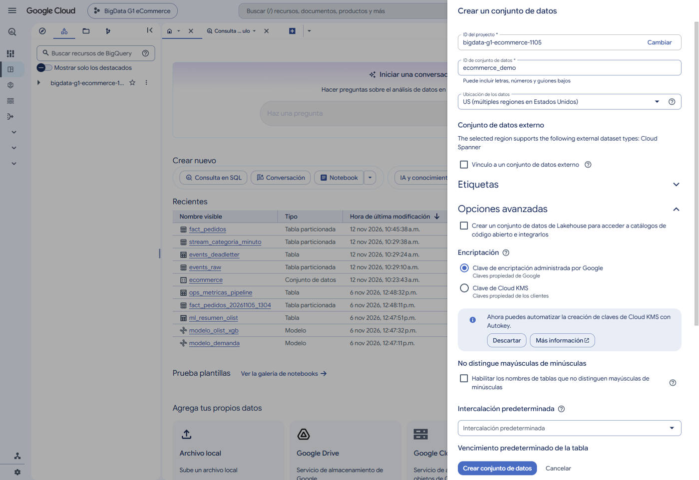
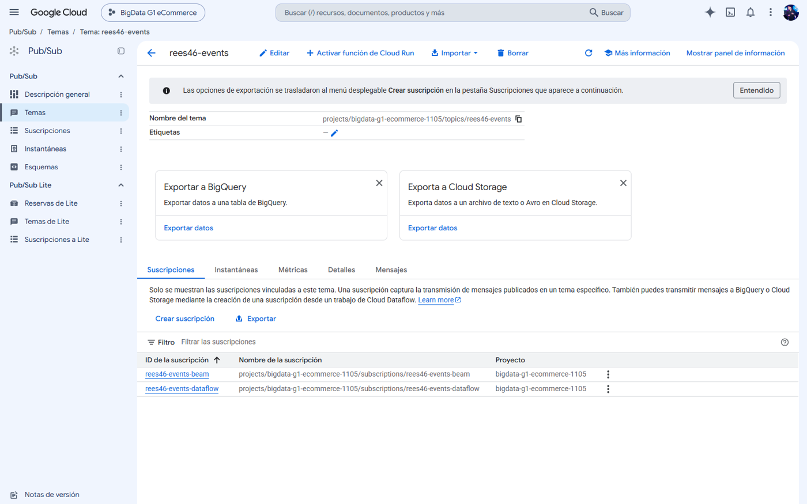
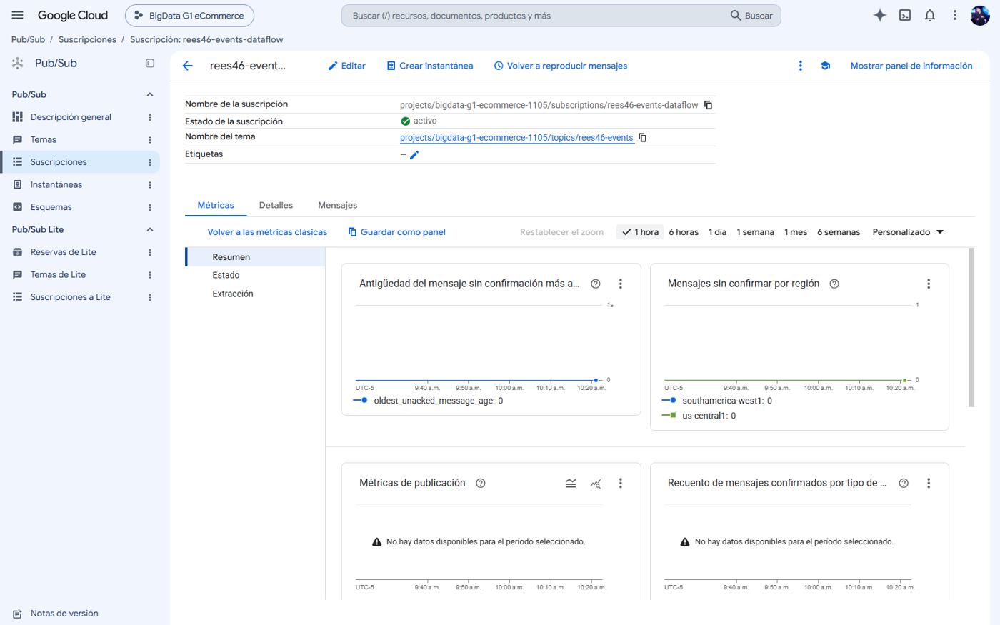
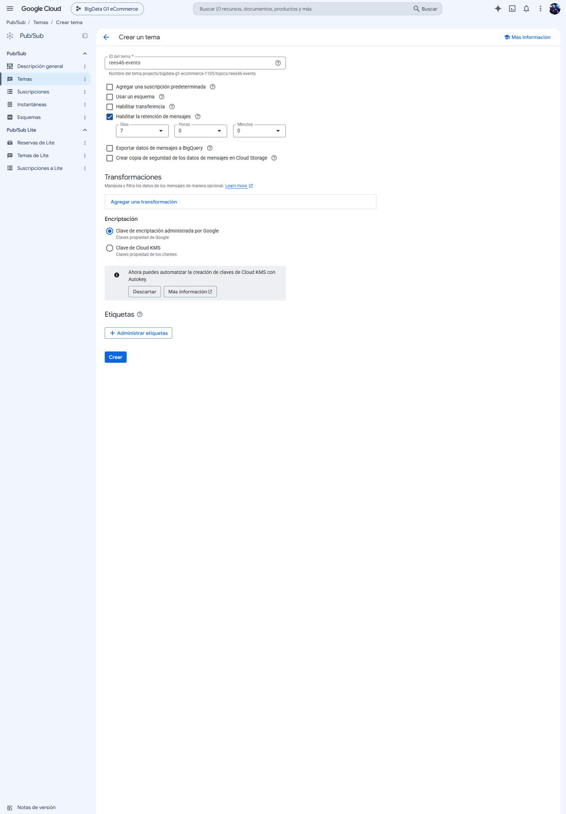
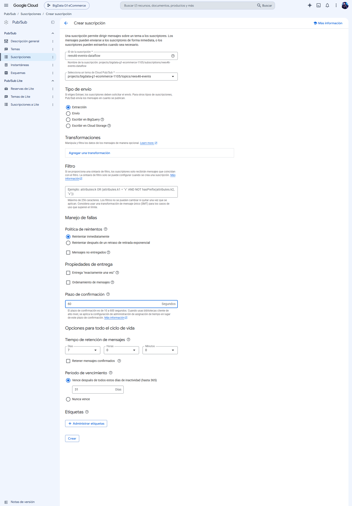

# 2. Almacenamiento, mensajería y warehouse

Script: `infra/01_setup.sh`. Es idempotente: si un recurso existe, lo deja como está.

```bash
./infra/01_setup.sh
```

## 2.1 Bucket del data lake (Cloud Storage)

```bash
gcloud storage buckets create "gs://$BUCKET" --location=US \
  --uniform-bucket-level-access --default-storage-class=STANDARD
gcloud storage buckets update "gs://$BUCKET" --versioning \
  --lifecycle-file=infra/lifecycle.json --update-labels=componente=storage
```

Decisiones:

- **Multirregión `US`**, para que el bucket y BigQuery estén en la misma ubicación y no se cobre transferencia.
- **Acceso uniforme** a nivel de bucket (sin ACL por objeto) y **versionado** activado: los CSV originales de la zona
  `raw/` no se modifican nunca, y si alguien los pisa se recupera la versión anterior.
- **Ciclo de vida** (`infra/lifecycle.json`): Standard → Nearline a los 30 días → Coldline a los 90. Los datos crudos casi
  no se vuelven a leer, así que bajan de tarifa solos.



En la pestaña **Ciclo de vida** se ven las dos reglas de cambio de clase de almacenamiento:



Estructura de carpetas del bucket:

| Ruta | Contenido |
|---|---|
| `raw/rees46/` | CSV originales de REES46 comprimidos con gzip, un archivo por mes. |
| `raw/olist/` | Los 9 CSV de Olist. |
| `replay/` | Archivos de un día de eventos, para simularlos en tiempo real. |
| `udf/` | `transform.js`, la función de validación de la plantilla de Dataflow. |
| `lookup/` | Exportación de `dim_producto` que usa el pipeline Beam. |
| `dataflow/` | Archivos temporales de Dataflow (`staging` y `temp`). |

## 2.2 Datasets de BigQuery

```bash
bq --location=US mk --dataset --max_time_travel_hours=168 --label=componente:bigquery \
   bigdata-g1-ecommerce-1105:ecommerce
bq --location=US mk --dataset --max_time_travel_hours=168 --label=componente:bigquery \
   bigdata-g1-ecommerce-1105:ecommerce_dr
```

- `ecommerce` es el dataset de trabajo (bronze, silver y gold).
- `ecommerce_dr` guarda los snapshots del plan de recuperación (capítulo 9).
- `--max_time_travel_hours=168` fija el máximo de **7 días** de *time travel*, que permite recuperar una tabla borrada
  o dañada.



Las tablas se crean después con `sql/01_ddl.sql` (la ejecuta `ingest/bq_load.sh`):

```sql
CREATE TABLE IF NOT EXISTS ecommerce.events_raw (
  event_time TIMESTAMP NOT NULL, event_type STRING NOT NULL, product_id INT64, category_id INT64,
  category_code STRING, brand STRING, price NUMERIC, user_id INT64, user_session STRING,
  source STRING,        -- 'batch' | 'stream'
  ingest_time TIMESTAMP)
PARTITION BY DATE(event_time)
CLUSTER BY event_type, category_code
OPTIONS (labels = [('componente', 'bigquery')]);
```

La tabla se **particiona por día** y se **agrupa (clustering)** por `event_type` y `category_code`: una consulta que
filtra por fecha escanea solo esas particiones. `events_staging` recibe los CSV con todas las columnas como texto y
vence a los 30 días.

Desde la consola, el mismo dataset se crea en el explorador de BigQuery: ⋮ junto al proyecto → **Crear un conjunto de
datos**. Se escribe el ID, se elige la ubicación multirregión `US` y, en *Opciones avanzadas*, se puede ajustar el
tiempo de viaje en el tiempo. (La captura usa el nombre ilustrativo `ecommerce_demo`; el formulario no se envió.)



## 2.3 Pub/Sub: un tópico y una suscripción por consumidor

```bash
gcloud pubsub topics create rees46-events --message-retention-duration=7d --labels=componente=pubsub
gcloud pubsub subscriptions create rees46-events-dataflow --topic=rees46-events \
  --ack-deadline=60 --message-retention-duration=7d --labels=componente=pubsub
gcloud pubsub subscriptions create rees46-events-beam --topic=rees46-events \
  --ack-deadline=60 --message-retention-duration=7d --labels=componente=pubsub
```

- **Retención de 7 días:** si un job de Dataflow cae, los mensajes esperan en Pub/Sub y se procesan al reiniciarlo.
- **Dos suscripciones** (*fan-out*): cada job de Dataflow lee de la suya, y los dos reciben todos los mensajes.





**Crear el tópico en la consola.** **Pub/Sub** → **Temas** → **Crear tema**: se escribe el ID, se desmarca *Agregar una
suscripción predeterminada* (creamos las nuestras) y se marca *Habilitar la retención de mensajes* para fijar 7 días.



**Crear la suscripción.** **Pub/Sub** → **Suscripciones** → **Crear suscripción**: ID `rees46-events-dataflow`, el
tópico `rees46-events`, tipo de envío *Extracción* (*pull*; Dataflow consulta los mensajes), plazo de confirmación de 60
segundos y retención de 7 días. Se repite con `rees46-events-beam`.



## 2.4 Presupuesto

El script crea un presupuesto con alertas al 50, 90 y 100 % (el monto va en la moneda de la cuenta de facturación,
soles en nuestro caso). Requiere la cuenta administradora de facturación (`BILLING_ADMIN`):

```bash
gcloud billing budgets create --billing-account="$BILLING_ACCOUNT" --account="$BILLING_ADMIN" \
  --display-name="presupuesto-$PROJECT_ID" --budget-amount="${BUDGET_PEN}PEN" \
  --filter-projects="projects/$PROJECT_ID" \
  --threshold-rule=percent=0.5 --threshold-rule=percent=0.9 --threshold-rule=percent=1.0
```

Salida esperada: `Setup OK: gs://<bucket>, ecommerce, ecommerce_dr, rees46-events/rees46-events-dataflow, budget 100 PEN`.
