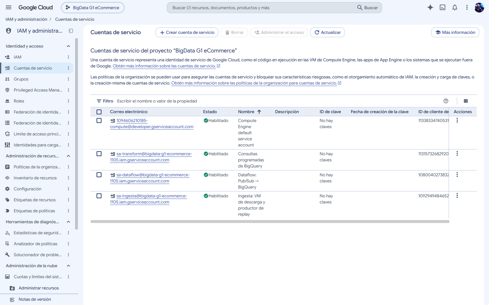
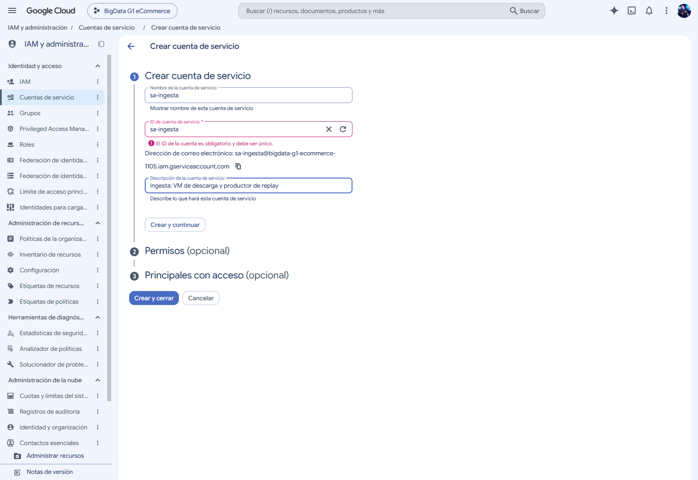
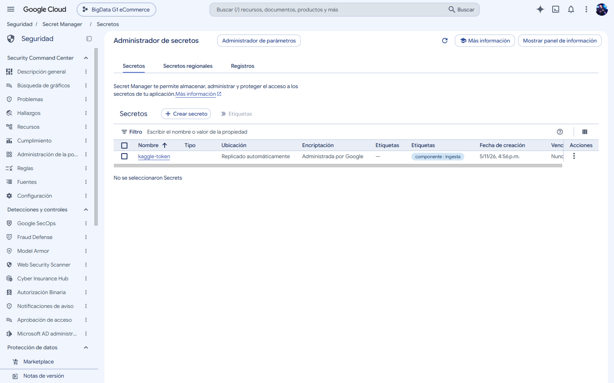
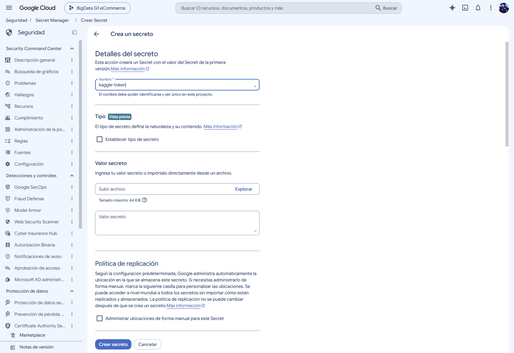

# 3. Identidades y secretos

Script: `infra/02_iam.sh` (lo ejecuta el dueño del proyecto).

```bash
./infra/02_iam.sh
```

## 3.1 Una cuenta de servicio por componente

Si todo corre con la cuenta por defecto de Compute Engine, que recibe el rol *Editor* del proyecto, cualquier fallo o
fuga de credenciales compromete todo. Por eso cada componente tiene su propia cuenta con solo lo que necesita:

| Cuenta | Componente | Permisos concedidos |
|---|---|---|
| `sa-ingesta` | VM: Kaggle → Cloud Storage y productor de replay | Escribir en el bucket (`storage.objectUser`), publicar en el tópico (`pubsub.publisher`), leer solo el secreto `kaggle-token`, ver métricas y escribir logs |
| `sa-dataflow` | Workers de Dataflow | `dataflow.worker`; `pubsub.subscriber` y `pubsub.viewer` sobre sus dos suscripciones; `storage.objectUser` en el bucket; `bigquery.dataEditor` solo sobre el dataset `ecommerce` |
| `sa-transform` | Consultas programadas | `bigquery.jobUser` y `bigquery.dataEditor` solo sobre `ecommerce` |

Las creaciones se hacen así:

```bash
gcloud iam service-accounts create sa-ingesta   --display-name="Ingesta: VM de descarga y productor de replay"
gcloud iam service-accounts create sa-dataflow  --display-name="Dataflow: Pub/Sub -> BigQuery"
gcloud iam service-accounts create sa-transform --display-name="Consultas programadas de BigQuery"
```

Y los permisos se otorgan en el recurso más pequeño posible (bucket, tópico, suscripción, secreto), no en el proyecto:

```bash
gcloud storage buckets add-iam-policy-binding "gs://$BUCKET" \
  --member="serviceAccount:$SA_INGESTA" --role=roles/storage.objectUser
gcloud pubsub topics add-iam-policy-binding "$TOPIC" \
  --member="serviceAccount:$SA_INGESTA" --role=roles/pubsub.publisher
gcloud secrets add-iam-policy-binding kaggle-token \
  --member="serviceAccount:$SA_INGESTA" --role=roles/secretmanager.secretAccessor
```

Los permisos sobre un dataset de BigQuery se dan con SQL, porque `bq add-iam-policy-binding` sobre datasets exige estar
en una lista de permitidos:

```sql
GRANT `roles/bigquery.dataEditor` ON SCHEMA `bigdata-g1-ecommerce-1105`.ecommerce
TO 'serviceAccount:sa-dataflow@bigdata-g1-ecommerce-1105.iam.gserviceaccount.com';
```

Al final el script **quita el rol Editor** a la cuenta por defecto de Compute Engine, porque ya nada la usa.



**Crear una cuenta de servicio en la consola.** **IAM y administración** → **Cuentas de servicio** → **Crear cuenta de
servicio**: nombre, ID (queda el correo `sa-ingesta@<proyecto>.iam.gserviceaccount.com`) y descripción. Los permisos se
otorgan después, recurso por recurso, como muestran los comandos de arriba.



## 3.2 El token de Kaggle en Secret Manager

El token de Kaggle nunca se copia con `scp` ni se guarda en el repositorio. Se crea una sola vez desde tu laptop:

```bash
gcloud secrets create kaggle-token --replication-policy=automatic \
  --data-file="$HOME/.kaggle/access_token" --labels=componente=ingesta
```

Y la VM lo lee con su propia identidad (`sa-ingesta`) al arrancar:

```bash
gcloud secrets versions access latest --secret=kaggle-token --project=$PROJECT_ID > ~/.kaggle/access_token
```



**Crear el secreto en la consola.** **Seguridad** → **Secret Manager** → **Crear secreto**: el nombre es `kaggle-token`
y el valor se sube como archivo (`~/.kaggle/access_token`) o se pega. Se deja la replicación automática.



## 3.3 Cómo comprobar el mínimo privilegio

Desde la VM (que corre como `sa-ingesta`) se verifica que puede lo que debe y nada más:

```bash
gcloud secrets versions access latest --secret=kaggle-token >/dev/null && echo "secreto: OK"
bq query --use_legacy_sql=false "SELECT 1"   # debe fallar: acceso denegado a BigQuery
```

El resultado completo de esta prueba está en `docs/evidencia/cuentas_servicio.txt`.
