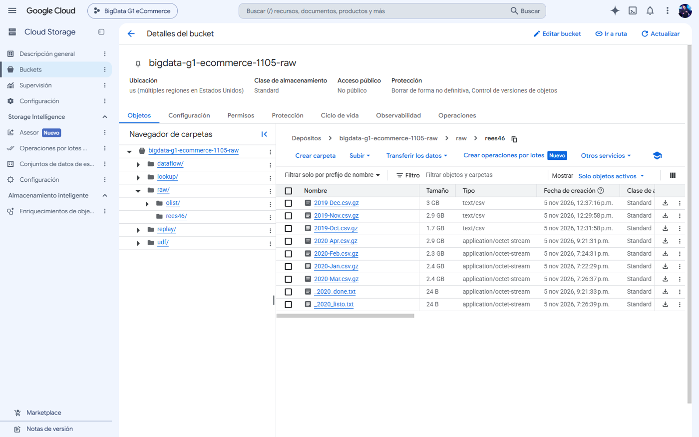

# 4. Ingesta batch

Flujo: Kaggle y el espejo de REES46 → VM efímera → Cloud Storage (`raw/`) → `bq load` → `events_staging` → `events_raw`.

## 4.1 Crear la VM efímera

Descargar 20 GB desde una laptop es lento y frágil. Una VM en la misma región que el bucket descarga a velocidad de
centro de datos y luego se borra. Script: `infra/03_vm.sh`.

```bash
./infra/03_vm.sh
```

Lo que hace por dentro:

```bash
gcloud compute instances create ingest-vm --zone=us-central1-a \
  --machine-type=e2-standard-4 --boot-disk-size=200GB --boot-disk-type=pd-standard \
  --image-family=debian-12 --image-project=debian-cloud \
  --service-account="$SA_INGESTA" --scopes=cloud-platform --labels=componente=ingesta

gcloud compute scp --zone=us-central1-a --tunnel-through-iap --recurse config.env ingest streaming monitoring ingest-vm:~/app/
gcloud compute ssh ingest-vm --zone=us-central1-a --tunnel-through-iap --command="\
  umask 077 && gcloud secrets versions access latest --secret=kaggle-token > ~/.kaggle/access_token && \
  sudo apt-get -qq install -y python3-venv unzip pigz && \
  python3 -m venv ~/venv && ~/venv/bin/pip -q install kaggle six google-cloud-pubsub google-cloud-monitoring"
```

- La VM usa la cuenta `sa-ingesta`, no la cuenta por defecto.
- El acceso es por **IAP** (`--tunnel-through-iap`), sin abrir el puerto 22 a internet.
- `e2-standard-4` con disco de 200 GB alcanza para descomprimir un mes de eventos.

Comprobación: dentro de la VM, el token está en su lugar y Kaggle responde con la lista de archivos
(salida real del 12 de noviembre de 2026, `docs/evidencia/vm_ingesta_12nov.txt`):

```
$ ls ~/app
config.env  ingest  monitoring  streaming
$ ~/venv/bin/kaggle datasets files mkechinov/ecommerce-behavior-data-from-multi-category-store
name           size        creationDate
2019-Nov.csv   9006762395  2019-12-09 20:52:13
2019-Oct.csv   5668612855  2019-12-09 20:51:21
$ ls -l ~/.kaggle
-rw------- 1 usuario usuario 38 Nov 12 15:17 access_token
```

## 4.2 Descargar los datos a Cloud Storage

`ingest/download_to_gcs.sh` corre **en la VM**:

```bash
gcloud compute ssh ingest-vm --zone=us-central1-a --tunnel-through-iap -- 'bash ~/app/ingest/download_to_gcs.sh'
```

Pasos del script:

1. Descarga de Kaggle los archivos de octubre y noviembre de 2019 de REES46 y los comprime con `pigz`.
2. Kaggle no trae diciembre: el script lo baja, junto con enero a abril de 2020, del espejo del autor
   (`https://data.rees46.com/datasets/marketplace/<AAAA>-<Mes>.csv.gz`). Tiene el mismo esquema.
3. Sube todo a `gs://<bucket>/raw/rees46/` sin modificarlo.
4. Descarga Olist y sube los 9 CSV a `raw/olist/`.
5. Extrae tres días completos (17/11, 29/11 y 02/12 de 2019) a `replay/`, ordenados por hora, para simularlos en tiempo
   real en el capítulo 5.



## 4.3 Cargar a BigQuery

`ingest/bq_load.sh` (se ejecuta desde la laptop; la carga con `bq load` no cuesta):

```bash
./ingest/bq_load.sh
```

Secuencia:

1. `sql/run.sh sql/01_ddl.sql` crea `events_raw` y `events_staging`.
2. `bq load --replace --source_format=CSV --skip_leading_rows=1 ecommerce.events_staging "gs://$BUCKET/raw/rees46/*.csv.gz" <esquema todo STRING>`.
   Se carga todo como texto para que ninguna fila inválida rompa la carga.
3. `sql/02_load_events.sql` convierte los tipos, descarta filas inválidas y deduplica con `SELECT DISTINCT` antes de
   insertar en `events_raw`.
4. Olist: ocho tablas con `--autodetect` y la de traducción de categorías con esquema explícito, porque su
   encabezado trae un BOM.
5. `seed/dim_categoria.csv` (mapeo manual a 18 categorías comunes) se carga en `dim_categoria`.
6. Se ejecutan en orden `sql/03_dims.sql`, `04_facts.sql`, `12_row_access.sql`, `06_fact_inventory.sql`,
   `05_analytics.sql`, `11_governance.sql` y `10_quality.sql`. El capítulo 7 explica cada uno.

Los días 17/11, 29/11 y 02/12 de 2019 **no** se cargan por lotes: entran solo por streaming, para que no se dupliquen.
La columna `events_raw.source` distingue `batch` de `stream`.

## 4.4 Apagar la VM

```bash
gcloud compute instances delete ingest-vm --zone=us-central1-a --quiet
```

(o `./infra/99_teardown.sh`, capítulo 11). Los datos quedan en el bucket y en BigQuery.
