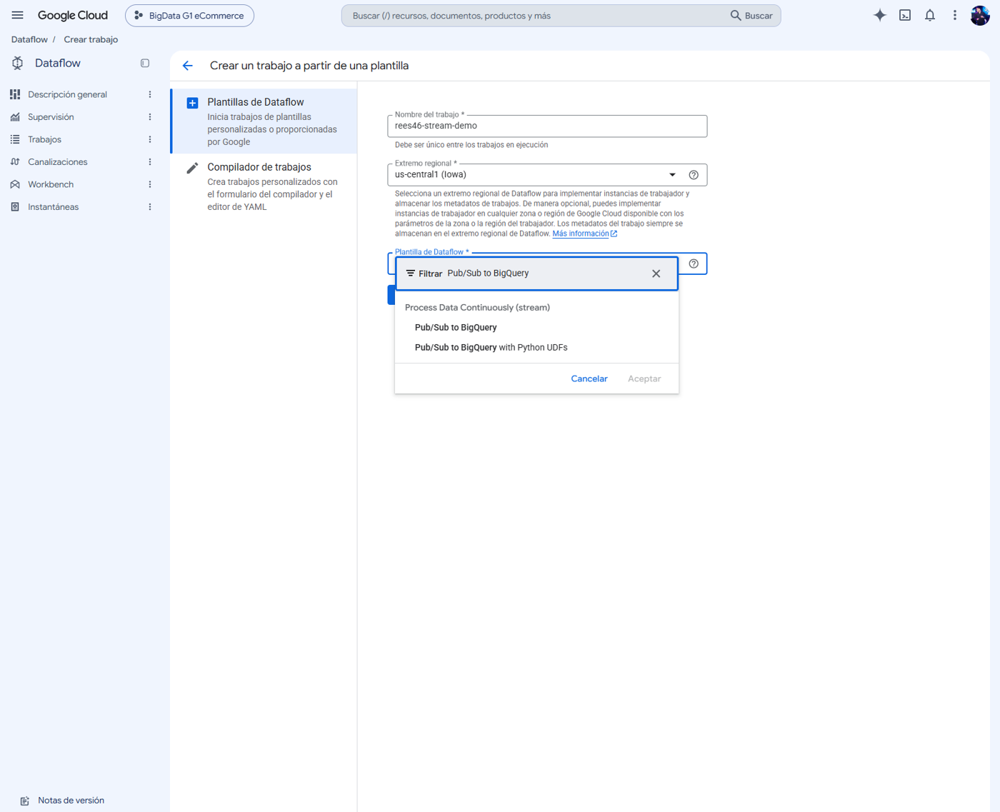
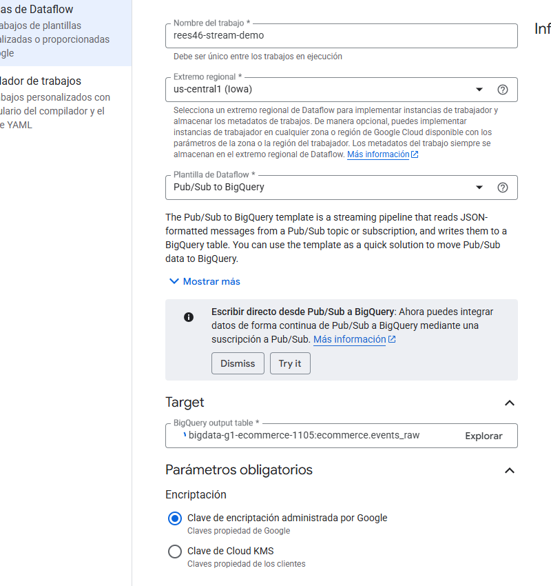
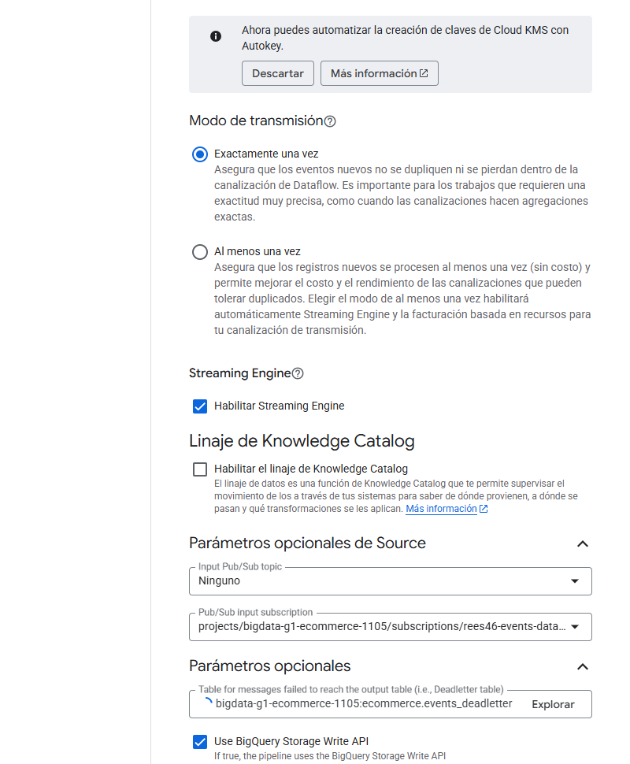
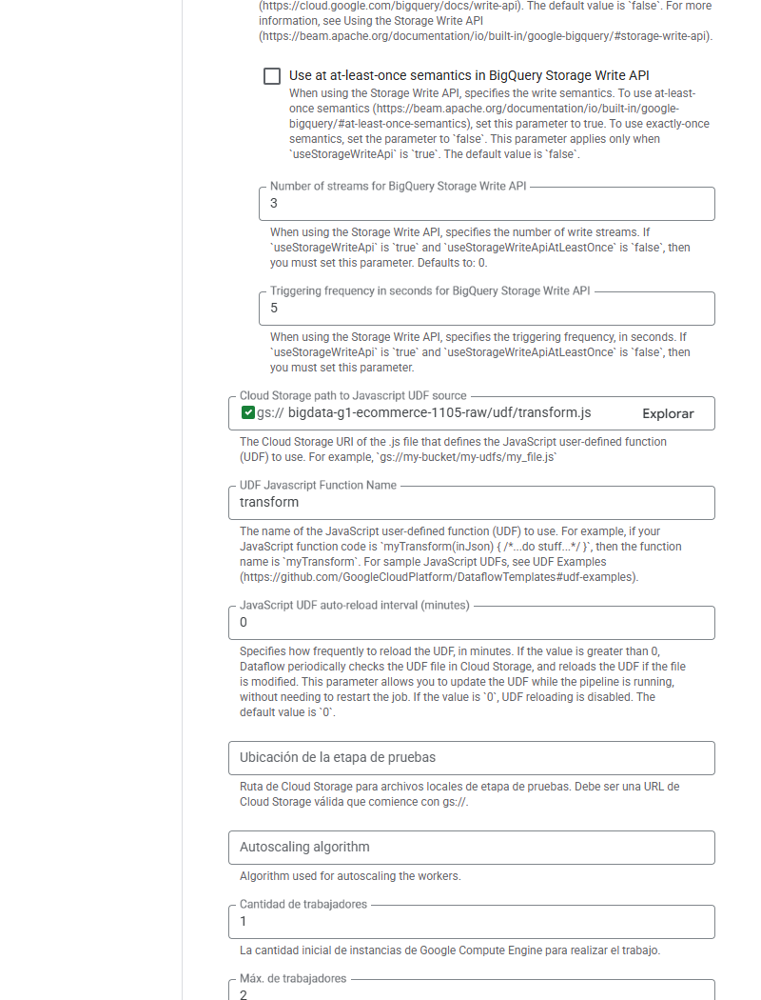
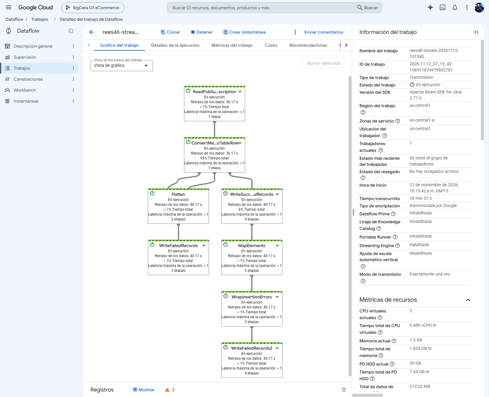
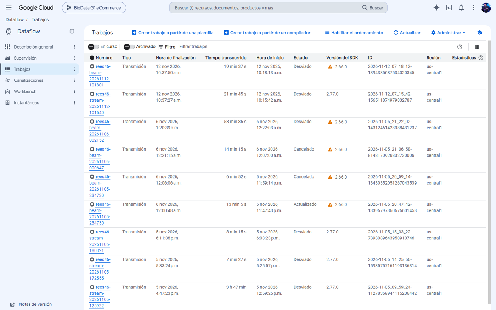

# 5. Streaming con la plantilla de Dataflow

Esta es la ruta en tiempo real más simple: **Pub/Sub → Dataflow (plantilla de Google) → BigQuery**. La plantilla
*Pub/Sub to BigQuery* lee los mensajes, los pasa por una función JavaScript propia (UDF) que los valida y normaliza, y
escribe el resultado en `events_raw`. Los mensajes que la UDF rechaza van a una tabla de errores
(`events_deadletter`) sin detener el flujo.

## 5.1 La función de validación (`streaming/udf/transform.js`)

La UDF recibe cada mensaje como texto JSON y devuelve el JSON que se insertará en BigQuery. Si lanza una excepción
(`throw`), la plantilla manda ese mensaje a la cola de errores con el motivo.

```javascript
var VALID_TYPES = {view: true, cart: true, remove_from_cart: true, purchase: true};
var TS_RE = /^\d{4}-\d{2}-\d{2} \d{2}:\d{2}:\d{2}/;
var INT_RE = /^\d+$/;

function transform(line) {
  var e = JSON.parse(line);
  if (blank(e.event_time) || !TS_RE.test(e.event_time)) throw 'invalid event_time: ' + e.event_time;
  if (!VALID_TYPES[e.event_type]) throw 'invalid event_type: ' + e.event_type;
  var price = null;
  if (!blank(e.price)) {
    price = Number(e.price);
    if (isNaN(price) || price < 0) throw 'invalid price: ' + e.price;
  }
  return JSON.stringify({
    event_time: e.event_time.substring(0, 19),
    event_type: e.event_type,
    product_id: intOrNull(e.product_id, 'product_id'),
    /* category_id, category_code, brand, user_id, user_session: igual, normalizados */
    price: price,
    source: 'stream',
    ingest_time: new Date().toISOString()
  });
}
```

(El archivo completo tiene 39 líneas y está en el repositorio.) Reglas que aplica: fecha con formato válido, tipo de
evento permitido, identificadores enteros y precio no negativo. Además marca la fila con `source = 'stream'` y la hora
de ingesta.

## 5.2 Crear el job desde la consola (paso a paso)

1. En la consola abre **Dataflow** → **Trabajos** → **Crear trabajo a partir de una plantilla**.
2. Escribe el **nombre del trabajo** (por ejemplo `rees46-stream-demo`), deja la región `us-central1` y, en
   **Plantilla de Dataflow**, escribe «Pub/Sub to BigQuery» y elige la primera opción (no la variante con UDF de Python).



3. Completa los parámetros. Los que usamos:

| Campo del formulario | Valor |
|---|---|
| BigQuery output table | `bigdata-g1-ecommerce-1105:ecommerce.events_raw` |
| Pub/Sub input subscription | `projects/bigdata-g1-ecommerce-1105/subscriptions/rees46-events-dataflow` |
| Table for messages failed to reach the output table (cola de errores) | `bigdata-g1-ecommerce-1105:ecommerce.events_deadletter` |
| Use BigQuery Storage Write API | marcado |
| Number of streams for BigQuery Storage Write API | `3` |
| Triggering frequency in seconds | `5` |
| Cloud Storage path to Javascript UDF source | `gs://<bucket>/udf/transform.js` (se sube antes con `gcloud storage cp streaming/udf/transform.js gs://<bucket>/udf/`) |
| UDF Javascript Function Name | `transform` |
| Cantidad de trabajadores / Máx. de trabajadores | `1` / `2` o `3` |
| Habilitar Streaming Engine | marcado |
| Cuenta de servicio | `sa-dataflow@bigdata-g1-ecommerce-1105.iam.gserviceaccount.com` |
| Ubicación temporal | `gs://<bucket>/dataflow/temp` |

La parte superior del formulario, con la tabla de destino, el modo de transmisión, Streaming Engine y la suscripción:



La parte intermedia, con la cola de errores y la Storage Write API:



Y la parte con la UDF y el tamaño del job:



> El formulario de las capturas está completo pero **no se ejecutó**: el job real se lanzó con el script del punto
> 5.3, que hace exactamente lo mismo y deja el comando documentado. Con el vínculo «línea de comandos» al pie del
> formulario, la consola muestra el `gcloud` equivalente.

## 5.3 Crear el job por línea de comandos (lo que usamos)

```bash
./streaming/launch_dataflow.sh          # opcional: ./streaming/launch_dataflow.sh us-east1 (otra región)
```

El script sube la UDF y lanza la plantilla flex:

```bash
gcloud storage cp streaming/udf/transform.js "gs://$BUCKET/udf/transform.js"
gcloud dataflow flex-template run "rees46-stream-$(date +%Y%m%d-%H%M%S)" \
  --project="$PROJECT_ID" --region="$REGION" \
  --template-file-gcs-location="gs://dataflow-templates-$REGION/latest/flex/PubSub_to_BigQuery_Flex" \
  --parameters="inputSubscription=projects/$PROJECT_ID/subscriptions/$SUBSCRIPTION" \
  --parameters="outputTableSpec=$PROJECT_ID:$DATASET.events_raw" \
  --parameters="outputDeadletterTable=$PROJECT_ID:$DATASET.events_deadletter" \
  --parameters="javascriptTextTransformGcsPath=gs://$BUCKET/udf/transform.js" \
  --parameters="javascriptTextTransformFunctionName=transform" \
  --parameters="useStorageWriteApi=true,numStorageWriteApiStreams=3,storageWriteApiTriggeringFrequencySec=5" \
  --num-workers=1 --max-workers="$DF_MAX_WORKERS" --worker-machine-type="$DF_MACHINE" \
  --enable-streaming-engine --service-account-email="$SA_DATAFLOW" \
  --staging-location="gs://$BUCKET/dataflow/staging" --temp-location="gs://$BUCKET/dataflow/temp" \
  --additional-user-labels=componente=dataflow
```

Salida real del 12 de noviembre de 2026:

```
job:
  id: 2026-11-12_07_15_42-156511874979832787
  location: us-central1
  name: rees46-stream-20261112-101540
  projectId: bigdata-g1-ecommerce-1105
```

Tarda unos 3 minutos en pasar de *Iniciando* a *En ejecución*. El grafo del job muestra los pasos de la plantilla:
`ReadPubSubSubscription` → `ConvertMessageToTableRow` → escritura de los registros correctos (`WriteSuccessfulRecords`) y
de los fallidos (`WriteFailedRecords`).



Decisiones de configuración:

- **Storage Write API** en lugar de *streaming inserts*: más barata y permite hacer `DELETE` sobre filas recientes (la
  deduplicación diaria lo necesita).
- **Streaming Engine**: el estado y la mezcla de datos se manejan fuera de las VM de los workers, y el autoescalado
  reacciona más rápido.
- **1 a 3 workers `n1-standard-2`**: limita el gasto. En el replay del pico, Dataflow escaló de 1 a 2 workers.

## 5.4 Simular el tráfico: el productor de replay

No hay una tienda real enviando eventos, así que repetimos un día real a velocidad acelerada con
`streaming/producer.py`, que lee un CSV ordenado por hora y publica cada fila como mensaje JSON en el tópico,
respetando el tiempo entre eventos dividido por `--speedup`:

```bash
python producer.py replay/rees46_2019-11-17.csv --project $PROJECT_ID --topic rees46-events --speedup 10
```

- `--speedup 10` reproduce un día de 24 h en 2,4 h; `60` lo hace en 24 minutos; `0` publica lo más rápido posible.
- Antes de terminar, el productor **espera la confirmación de Pub/Sub de cada mensaje**. Sin esa espera, una VM que
  se apagaba al terminar perdía los últimos mensajes: un fallo que descubrimos en la prueba de Beam y corregimos.
- `--dry-run` imprime tres mensajes sin publicar nada.

El script `streaming/run_replays.sh` encadena tres replays desde la VM: 02/12 y 29/11 a 60x, y 17/11 a 10x (el pico).

```bash
gcloud compute ssh ingest-vm --zone=us-central1-a --tunnel-through-iap -- \
  'nohup bash ~/app/streaming/run_replays.sh > ~/replays.log 2>&1 &'
```

Registro real de un replay de 30 minutos del pico (12/11/2026; `docs/evidencia/replay_12nov.log`):

```
slice: 227830 events 2019-11-17 10:30:00 UTC - 2019-11-17 10:59:59 UTC
published 3 invalid messages
START 2026-11-12T15:22:00+00:00
36530 events, 1218 ev/s, event_time=2019-11-17 10:35:00 UTC, failed=0
...
DONE 227830 events in 180s (1265 ev/s), confirmed=227830, failed=0
END 2026-11-12T15:25:01+00:00
```

## 5.5 La cola de errores

El replay incluye tres mensajes inválidos a propósito: un tipo de evento inexistente (`hack`), un texto que no es JSON y
un precio negativo. Los tres llegan a `ecommerce.events_deadletter` con el motivo del rechazo:

```sql
SELECT timestamp, payloadString, errorMessage FROM ecommerce.events_deadletter ORDER BY timestamp DESC LIMIT 3;
```

| payloadString | errorMessage |
|---|---|
| `{"event_time": "2019-11-17 10:05:00 UTC", "event_type": "purchase", "product_id": "1", "price": "-5"}` | `invalid price: -5 in <eval> at line number 24 …` (plantilla) |
| `no es json` | `beam: Expecting value: line 1 column 1 (char 0)` |
| `{"event_time": "…", "event_type": "hack", "product_id": "1"}` | `beam: invalid event_type: hack` |

(Las filas con prefijo `beam:` las escribe el pipeline del capítulo 6, que usa el mismo formato de tabla.)

## 5.6 Detener el job sin perder mensajes

```bash
./streaming/stop_dataflow.sh      # drain: termina lo que está en curso y luego se detiene
```

`drain` evita cancelar de golpe: los mensajes en vuelo se terminan de procesar. En la lista de trabajos el estado
final aparece como **Desviado** (*drained*).



> **Nota sobre duplicados.** Pub/Sub entrega al menos una vez y la plantilla no deduplica. La consulta programada
> diaria (capítulo 9, `sql/14_incremental.sql`) deja una sola copia de cada evento idéntico. Si repites un replay de
> un día que ya está en `events_raw`, aparecen filas dobles hasta esa limpieza.
