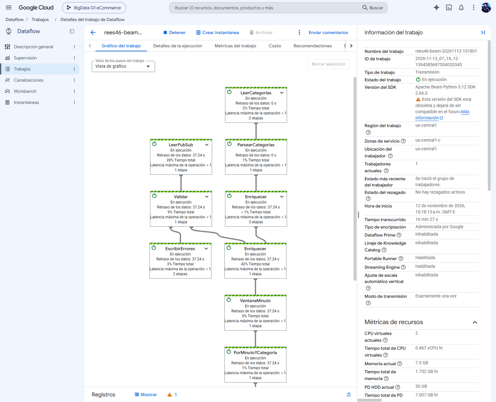
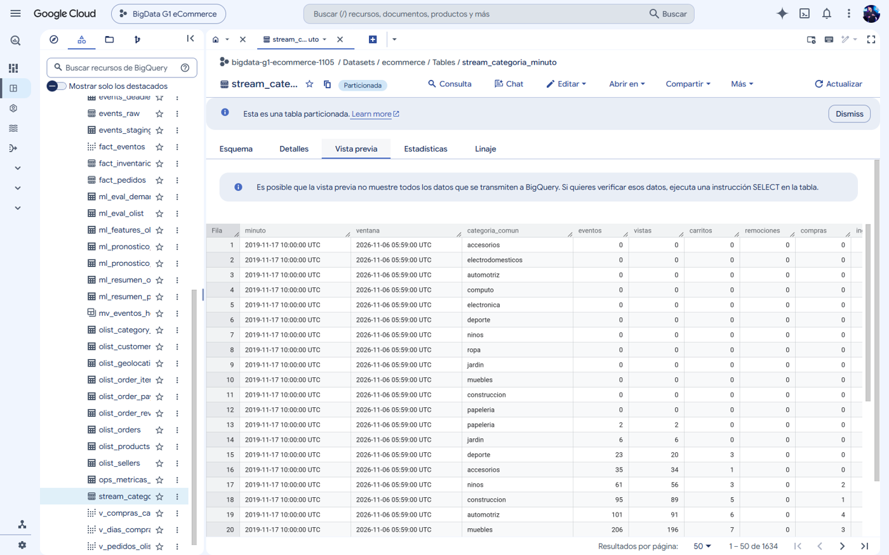

# 6. Streaming con un pipeline Apache Beam propio

La plantilla del capítulo 5 solo valida y copia. Para **limpiar, enriquecer y agregar** en tiempo real escribimos un
pipeline propio en Python con Apache Beam, que Dataflow ejecuta a escala. Código: `streaming/beam/pipeline.py`
(182 líneas) y prueba unitaria `streaming/beam/test_pipeline.py`.

## 6.1 Qué hace

```
Pub/Sub (suscripción rees46-events-beam)
   → Validar          descarta mensajes inválidos hacia events_deadletter (con el motivo)
   → Enriquecer       agrega la categoría común del producto (side input)
   → VentanaMinuto    ventanas fijas de 1 minuto
   → PorMinutoYCategoria + Contar   eventos, vistas, carritos, remociones, compras e ingresos
   → EscribirAgregados   BigQuery: stream_categoria_minuto (capa gold)
```



El grafo de la captura corresponde al código: `LeerPubSub` → `Validar` → (`EscribirErrores` | `Enriquecer`) →
`VentanaMinuto` → `PorMinutoYCategoria` → `Contar` → `EscribirAgregados`. La rama de la izquierda, `LeerCategorias` →
`ParsearCategorias`, carga la tabla de categorías.

## 6.2 Primero: la tabla de destino y la función de conciliación

```bash
sql/run.sh sql/19_stream_aggregates.sql
```

Crea `ecommerce.stream_categoria_minuto` (particionada por día de `minuto` y agrupada por `categoria_comun`) y la
función `ecommerce.conciliar_stream(desde, hasta)`, que compara el resultado en tiempo real con el mismo agregado
calculado por lotes sobre `fact_eventos`.

## 6.3 El código, paso a paso

**Validación.** `parse_event` aplica las mismas reglas que la UDF del capítulo 5. Un `DoFn` con salida etiquetada
separa los mensajes buenos de los malos; los malos se escriben con el mismo formato que usa la plantilla
(`timestamp`, `payloadString`, `payloadBytes`, `errorMessage`):

```python
class ParseAndValidate(beam.DoFn):
    def process(self, payload):
        raw = payload if isinstance(payload, bytes) else payload.encode("utf-8")
        text = raw.decode("utf-8", errors="replace")
        try:
            ev = parse_event(text)
        except (ValueError, TypeError, KeyError) as err:
            self.invalid.inc()          # contador visible en Dataflow
            yield beam.pvalue.TaggedOutput(INVALID, {
                "timestamp": datetime.now(timezone.utc).isoformat(),
                "payloadString": text,
                "payloadBytes": base64.b64encode(raw).decode("ascii"),
                "errorMessage": f"beam: {err}"})
            return
        yield ev
```

**Enriquecimiento con un side input.** Cada evento recibe la categoría común de su producto. Los 386 299 productos
de `dim_producto` se exportan a un CSV en Cloud Storage y se cargan como diccionario (`AsDict`) que Beam reparte a los
workers:

```python
categories = (p | "LeerCategorias" >> beam.io.ReadFromText(lookup_path, skip_header_lines=1)
                | "ParsearCategorias" >> beam.Map(parse_lookup_line))
rows = (parsed.ok
        | "Enriquecer" >> beam.Map(enrich, categories=beam.pvalue.AsDict(categories))
```

Un producto que no está en `dim_producto` queda como `sin_categoria`.

**Ventanas y disparadores.** Usamos ventanas fijas de 60 segundos según la **hora de llegada** a Pub/Sub, no la hora
del evento. Esto importa: los eventos del replay son de 2019, y si la ventana se midiera por su hora, el *watermark*
los descartaría como tardíos de hace años. La clave de agregación sí incluye el minuto del evento, así que el
resultado se puede cruzar con el cálculo por lotes:

```python
| "VentanaMinuto" >> beam.WindowInto(
    window.FixedWindows(60), trigger=AfterWatermark(late=AfterProcessingTime(30)),
    accumulation_mode=AccumulationMode.DISCARDING, allowed_lateness=600)
| "PorMinutoYCategoria" >> beam.Map(lambda ev: ((ev["event_time"].replace(second=0).isoformat(), ev["categoria_comun"]), ev))
| "Contar" >> beam.CombinePerKey(CountByType())
```

Con `DISCARDING` cada evento se cuenta en exactamente una fila; quien consulta suma las filas de un mismo
(minuto, categoría). Los eventos que llegan hasta 10 minutos tarde generan una fila extra marcada `tardio`.

**Escritura.** `WriteToBigQuery` con `CREATE_NEVER` (la tabla ya existe) y `WRITE_APPEND`, para los agregados y para la
cola de errores.

## 6.4 Probar el pipeline sin nube

```bash
cd streaming/beam && python -m pytest test_pipeline.py
```

La prueba corre el mismo `build()` con el `DirectRunner` y datos en memoria. También corre en GitHub Actions
en cada `push` (`.github/workflows/ci.yml`).

## 6.5 Lanzarlo en Dataflow

```bash
export REQUESTS_CA_BUNDLE=/etc/ssl/certs/ca-certificates.crt HTTPLIB2_CA_CERTS=$REQUESTS_CA_BUNDLE   # solo detrás de un proxy TLS
./streaming/beam/launch.sh
```

El script exporta primero el diccionario producto → categoría y luego envía el job:

```bash
bq query --use_legacy_sql=false "EXPORT DATA OPTIONS (uri='gs://$BUCKET/lookup/dim_producto_categoria-*.csv',
  format='CSV', header=TRUE, overwrite=TRUE) AS
  SELECT product_id, IFNULL(categoria_comun,'sin_categoria') AS categoria_comun FROM ecommerce.dim_producto"

~/.venvs/beam312/bin/python streaming/beam/pipeline.py \
  --subscription=projects/$PROJECT_ID/subscriptions/rees46-events-beam \
  --lookup="gs://$BUCKET/lookup/dim_producto_categoria-*.csv" \
  --output_table=$PROJECT_ID:ecommerce.stream_categoria_minuto \
  --deadletter_table=$PROJECT_ID:ecommerce.events_deadletter \
  --runner=DataflowRunner --project=$PROJECT_ID --region=us-central1 \
  --job_name=rees46-beam-$(date +%Y%m%d-%H%M%S) --service_account_email=$SA_DATAFLOW \
  --temp_location=gs://$BUCKET/dataflow/temp --staging_location=gs://$BUCKET/dataflow/staging \
  --enable_streaming_engine --num_workers=1 --max_num_workers=$DF_MAX_WORKERS \
  --machine_type=$DF_MACHINE --labels=componente=dataflow --save_main_session
```

Salida real: `Submitted job: 2026-11-12_07_18_12-1394385687534020345`. Para reemplazar un job en marcha conservando su
estado: `UPDATE_JOB=<nombre del job> ./streaming/beam/launch.sh`.

## 6.6 Probar de punta a punta y conciliar con el batch

`streaming/beam/test_replay.sh` exporta de `events_raw` un tramo del 17/11/2019 (por defecto 30 minutos), levanta una VM
pequeña `replay-beam` que lo publica a 10x junto con 3 mensajes inválidos, y se apaga sola:

```bash
./streaming/beam/test_replay.sh "2019-11-17 10:30:00" "2019-11-17 11:00:00"
```

Cuando termina (3 a 4 minutos después de cerrar cada ventana), se concilia:

```sql
SELECT COUNT(*) AS combinaciones, COUNTIF(NOT coincide) AS distintas
FROM ecommerce.conciliar_stream('2019-11-17 10:30:00', '2019-11-17 11:00:00');
```

Resultado de referencia (`docs/evidencia/beam_conciliacion.txt`): 227 830 eventos, **379 de 379** combinaciones
(minuto × categoría) idénticas al cálculo por lotes en eventos, compras e ingresos al centavo, y los 3 mensajes
inválidos en `events_deadletter`.



> **Importante al repetir la prueba.** El job de la plantilla (capítulo 5) también recibe estos mensajes y los
> insertaría por segunda vez en `events_raw`. Detén ese job antes (`./streaming/stop_dataflow.sh`) o desplaza su
> suscripción al presente con `gcloud pubsub subscriptions seek rees46-events-dataflow --time=<ahora>`.
> Si repites un tramo con el job de la plantilla encendido, tendrás que borrar los duplicados de `events_raw`.
