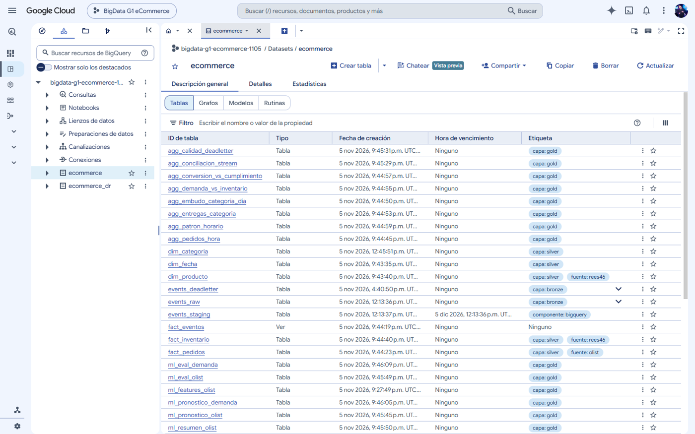
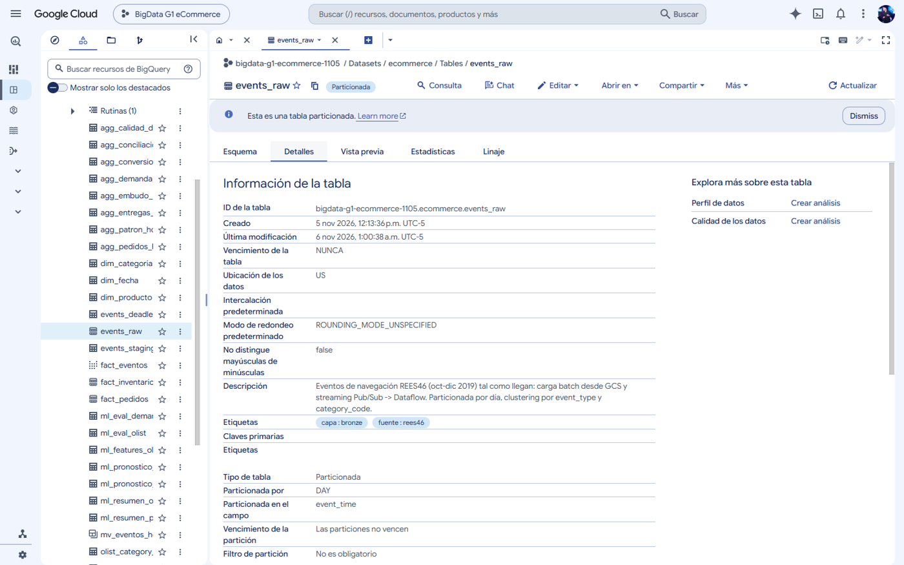
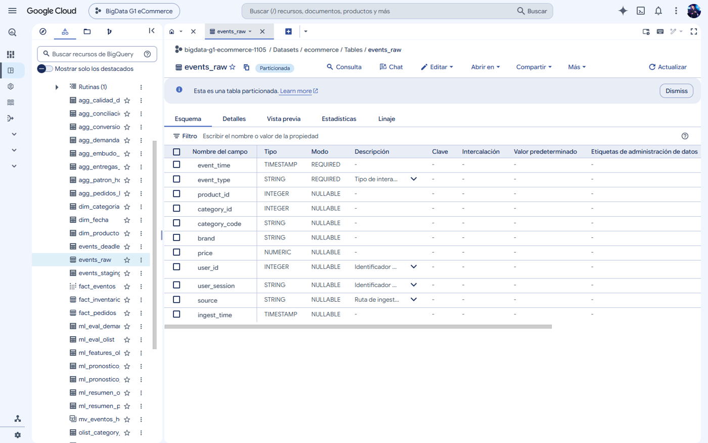

# 7. Modelo analítico: capas bronze, silver y gold

Todo se ejecuta con `sql/run.sh`, que aplica el tope de bytes facturados (`MAX_BYTES_BILLED`) y etiqueta cada consulta.
`ingest/bq_load.sh` los encadena; aquí se explica cada uno.

| Capa | Qué contiene | Tablas |
|---|---|---|
| **Bronze** | Datos tal como llegan | `events_raw`, `events_staging`, `events_deadletter`, `olist_*` |
| **Silver** | Modelo integrado y limpio | `dim_fecha`, `dim_categoria`, `dim_producto`, `fact_eventos`, `fact_pedidos`, `fact_inventario` |
| **Gold** | Tablas pequeñas para tableros y ML | `agg_*`, `mv_eventos_hora`, `stream_categoria_minuto`, `ml_*` |

Cada tabla lleva la etiqueta `capa` (`sql/11_governance.sql`), visible en la consola:



## 7.1 Bronze: `events_raw`

Se crea en `sql/01_ddl.sql` y se llena en `sql/02_load_events.sql` (batch) y por Dataflow (streaming). Esquema y
configuración de partición y clustering:





`02_load_events.sql` toma `events_staging` (todo texto), convierte tipos con `SAFE_CAST` para que una fila mala no rompa el
proceso, descarta las inválidas y deduplica con `SELECT DISTINCT`. Excluye los tres días que entran por streaming.

## 7.2 Silver

- **`sql/03_dims.sql`**: `dim_fecha` (un día por fila, de 2016 a abr 2020), `dim_categoria` (ya cargada desde
  `seed/dim_categoria.csv`) y `dim_producto`. Esta última fija **una categoría por producto** a partir de octubre y
  noviembre: desde diciembre el origen cambió la numeración de `category_id` y el 76 % de las compras de diciembre
  traía una categoría distinta a la del producto. Los productos nuevos heredan categoría por un *puente*: cada
  `category_id` nuevo toma la categoría de la mayoría de sus productos compartidos, siempre que sean al menos 5 y haya
  80 % de acuerdo.
- **`sql/04_facts.sql`**: `fact_eventos` es una **vista** sobre `events_raw` (no copia datos) que agrega la categoría
  estable. `fact_pedidos` une las 9 tablas de Olist: convierte la hora de São Paulo a UTC, calcula días hasta el
  despacho, días de entrega y atraso respecto a la fecha estimada, y toma el medio de pago principal.
- **`sql/06_fact_inventory.sql`**: REES46 no trae stock. Supuesto explícito: cada producto empieza la semana con 50
  unidades, cada compra descuenta una y el lunes se repone. De ahí salen los quiebres de stock.

## 7.3 Gold

`sql/05_analytics.sql` crea las tablas que consume Looker Studio:

| Tabla | Pregunta que responde |
|---|---|
| `agg_pedidos_hora` | Pedidos e ingresos por hora |
| `agg_embudo_categoria_dia` | Cuántas sesiones llegan de `view` a `cart` y a `purchase`, por categoría |
| `agg_entregas_categoria` | Tiempos de entrega y atrasos de Olist por categoría |
| `agg_demanda_vs_inventario` | Demanda frente al stock derivado (cruce con `fact_inventario`) |
| `agg_conversion_vs_cumplimiento` | Conversión de REES46 frente a cumplimiento de Olist, por categoría común |
| `agg_patron_horario` | Patrón hora × día de la semana de ambas tiendas |
| `mv_eventos_hora` | Vista materializada de eventos por hora |

Looker responde en 0,17 a 0,25 s porque lee tablas de kilobytes: la misma pregunta escanea 21 947 MB sobre
`events_raw` con `SELECT *` y 0,1 MB sobre la tabla agregada (`sql/09_bytes_scanned.sh`).

## 7.4 Streaming y capa gold

`sql/19_stream_aggregates.sql` agrega `stream_categoria_minuto` (capítulo 6), que Looker usa en la página de streaming.

## 7.5 Cargas posteriores: enero a abril de 2020

`ingest/fetch_2020.sh [meses]` baja los meses a Cloud Storage desde una VM que se borra sola, y `sql/17_load_2020.sql`
los carga con el mismo parseo y deduplicación; reemplaza solo los meses presentes, así que se puede repetir.

## 7.6 Verificar

```bash
sql/run.sh sql/10_quality.sql        # eventos por fuente, filas por tabla, nulos
sql/run.sh sql/07_peak.sql           # volumen diario y factor de pico
```

`events_raw` debe sumar unos 410 M de eventos (oct 2019 – abr 2020).
