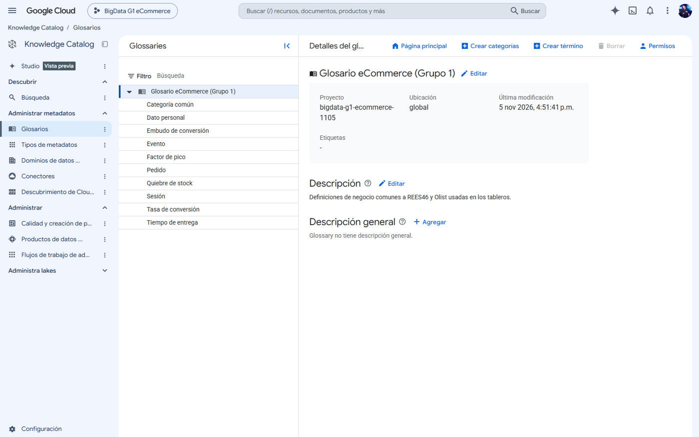
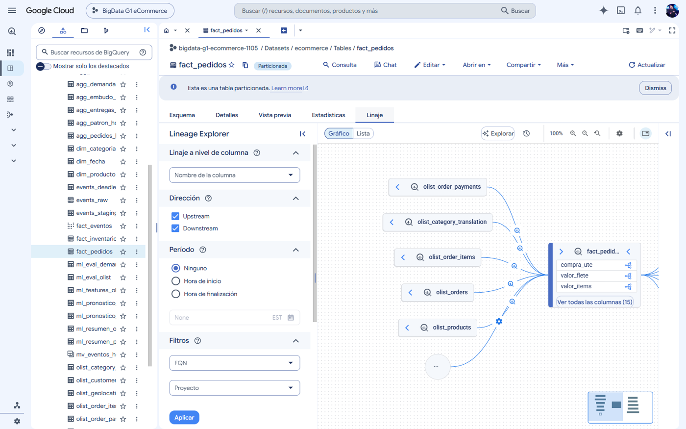
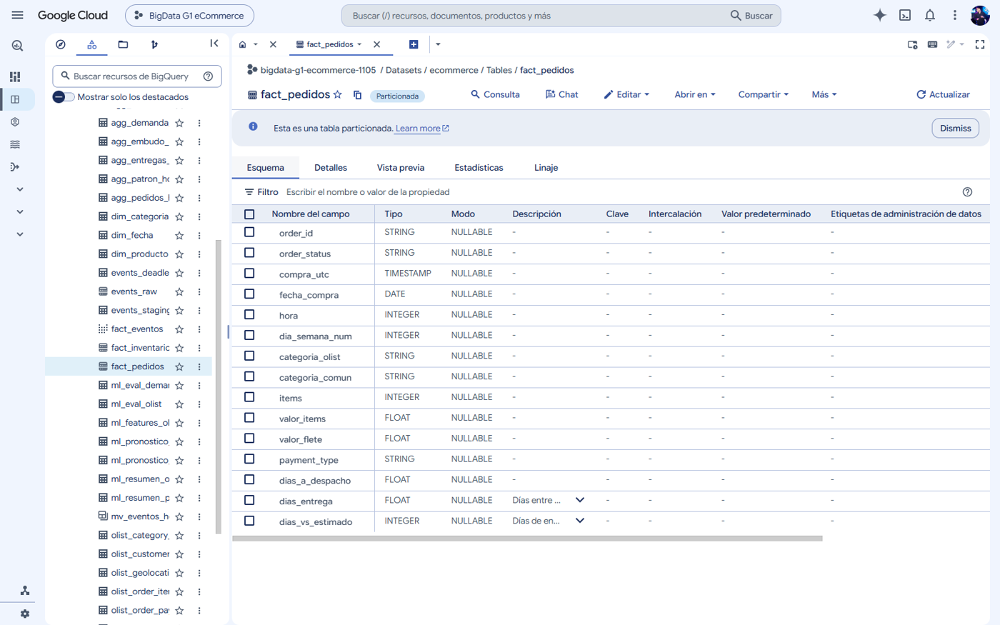

# 8. Gobierno de datos y acceso fino

Tres piezas: metadatos y capas (`sql/11_governance.sql`), glosario y linaje en Dataplex (`infra/05_governance.sh`) y
control de acceso por columna (`infra/04_fine_grained_access.py`) y por fila (`sql/12_row_access.sql`).

## 8.1 Capas, etiquetas y descripciones

```bash
sql/run.sh sql/11_governance.sql
```

Pone a cada tabla la etiqueta `capa` (bronze, silver o gold) y `fuente`, y una descripción en la tabla y en las columnas
clave. Dataplex las cataloga solo, y se pueden buscar con `labels.capa=gold`.

## 8.2 Glosario de negocio y linaje (Dataplex)

```bash
./infra/05_governance.sh
```

El script habilita las APIs (`dataplex`, `datalineage`, `datacatalog`), crea el glosario `glosario-ecommerce` y 10
términos con `gcloud dataplex glossaries terms create`:

```bash
gcloud dataplex glossaries create glosario-ecommerce --location=global \
  --display-name="Glosario eCommerce (Grupo 1)" \
  --description="Definiciones de negocio comunes a REES46 y Olist usadas en los tableros."
gcloud dataplex glossaries terms create pedido --glossary=glosario-ecommerce --location=global \
  --parent="projects/$PROJECT_ID/locations/global/glossaries/glosario-ecommerce" \
  --display-name="Pedido" --description="REES46: sesión con al menos un evento purchase. Olist: un order_id."
```

Los términos son: evento, sesión, pedido, embudo de conversión, tasa de conversión, categoría común, tiempo de entrega,
quiebre de stock, factor de pico y dato personal.



**Linaje.** Con la API de linaje habilitada, cada trabajo de BigQuery registra de qué tablas lee y a cuáles escribe.
No requiere más configuración: en BigQuery, abre una tabla (aquí `fact_pedidos`) → pestaña **Linaje** y se ve de qué
tablas de Olist sale. Para seguir un clic crudo hasta la métrica, abre `agg_embudo_categoria_dia` y expande hacia atrás
hasta `events_raw`.



## 8.3 Acceso por columna: policy tags

```bash
python3 infra/04_fine_grained_access.py     # necesita ser dueño del proyecto
```

Lo que hace el script con la API de Data Catalog:

1. Crea la taxonomía `datos-personales` en la ubicación `us`, con control de acceso detallado activado.
2. Crea dos policy tags: `identificador_usuario` (para `events_raw.user_id`) e `identificador_cliente` (para
   `olist_customers.customer_unique_id`).
3. Otorga el rol `datacatalog.categoryFineGrainedReader` solo al dueño, al compañero de equipo y a `sa-transform`
   (la deduplicación diaria compara filas completas, incluido `user_id`).
4. Asocia cada tag a su columna en el esquema de la tabla.

Efecto: quien no tiene ese rol recibe «acceso denegado» si incluye la columna en su consulta, pero puede consultar el
resto de la tabla. Prueba (`docs/evidencia/acceso_fino.txt`): la cuenta del analista de ejemplo ejecuta
`SELECT user_id …` y falla; `SELECT * EXCEPT (user_id) …` funciona.

## 8.4 Acceso por fila: row access policies

```bash
sql/run.sh sql/12_row_access.sql
```

```sql
CREATE OR REPLACE ROW ACCESS POLICY acceso_total ON ecommerce.fact_pedidos
GRANT TO ('user:<dueño>', 'user:<compañero>', 'serviceAccount:<sa-transform>') FILTER USING (TRUE);

CREATE OR REPLACE ROW ACCESS POLICY analista_muebles ON ecommerce.fact_pedidos
GRANT TO ('user:<analista>') FILTER USING (categoria_comun = 'muebles');
```

Cuando una tabla tiene alguna política de fila, quien no esté nombrado en ninguna ve **cero filas**; por eso los
accesos completos llevan su propia política con `TRUE`. Los `CREATE OR REPLACE TABLE` borran las políticas, así que
hay que volver a ejecutar este script tras reconstruir `fact_pedidos`. Resultado: el analista ve solo la categoría
muebles.

La captura muestra el esquema de `fact_pedidos` (las columnas de las tablas con policy tag muestran un ícono de
etiqueta en la columna correspondiente):



## 8.5 Límite conocido

El **enmascaramiento dinámico** (data policies que devuelven un hash en lugar de denegar) exige que el proyecto
pertenezca a una organización de Google Cloud. El nuestro no pertenece a ninguna, así que solo se aplica la denegación
de columna. Es el siguiente paso si el cliente lo monta en una organización.
