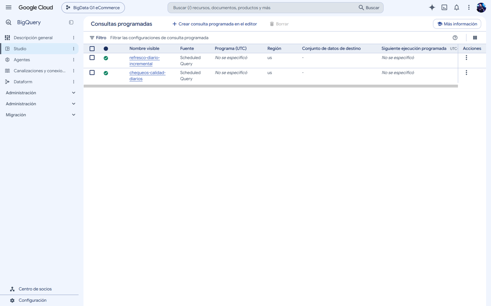
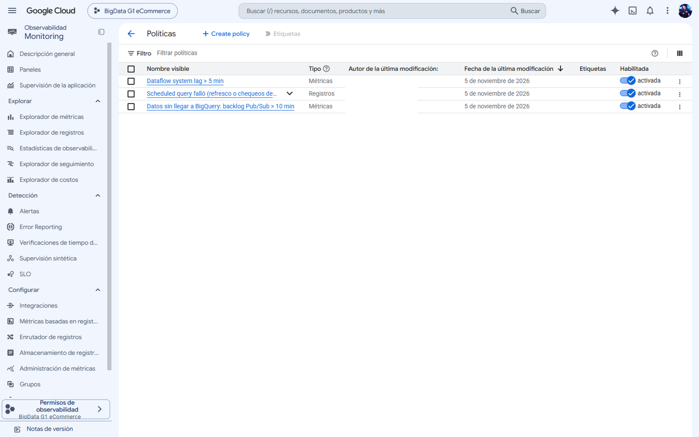

# 9. Operación, alertas y recuperación

## 9.1 Consultas programadas

```bash
./infra/06_scheduled_queries.sh
```

Crea dos consultas programadas, ambas con la identidad `sa-transform`:

| Nombre | Hora (UTC) | Archivo | Qué hace |
|---|---|---|---|
| `refresco-diario-incremental` | 06:00 | `sql/14_incremental.sql` | Deduplica el streaming y refresca solo las particiones modificadas en las últimas 26 horas |
| `chequeos-calidad-diarios` | 07:00 | `sql/15_checks.sql` | Falla (`ASSERT`) si algún control no se cumple |

```bash
bq mk --transfer_config --project_id=$PROJECT_ID --location=US \
  --data_source=scheduled_query --display_name="refresco-diario-incremental" --schedule="every day 06:00" \
  --service_account_name="$SA_TRANSFORM" --params='{"query": "<contenido de sql/14_incremental.sql>"}'
```

Para actualizar una consulta existente se usa `bq update --transfer_config --update_credentials …` (sin
`--update_credentials` no cambia la cuenta de servicio).

Detalle de `sql/14_incremental.sql`:

1. Lee de `INFORMATION_SCHEMA.PARTITIONS` (metadatos, gratis) las particiones de `events_raw` modificadas en 26 h.
2. Elimina duplicados del streaming (`ROW_NUMBER()` sobre todas las columnas del evento, dentro de una transacción);
   nunca toca filas `batch`.
3. Con `DELETE` + `INSERT` reconstruye solo `fact_inventario` y los `agg_*` de esas fechas. Al usar DML, se conservan
   descripciones, etiquetas y row access policies.

Chequeos de `sql/15_checks.sql`: rechazos en la cola de errores, agregados que no cuadran con la capa raw, claves nulas,
duplicados, saltos de más de 4x por categoría en una semana y proporción de compras sin categoría.



> Desde el 6 de noviembre de 2026 las dos consultas están **en pausa**, porque los datos ya no cambian y el refresco
> diario facturaba unos 60 GiB por corrida tras la carga de 2020. Para reactivarlas:
> `bq update --transfer_config --no_auto_scheduling=false <nombre de la configuración>` (los nombres salen de
> `bq ls --transfer_config --transfer_location=us`).

## 9.2 Alertas de Cloud Monitoring

```bash
./monitoring/setup_alerts.sh
```

Crea un canal de correo (`ALERT_EMAIL`) y una política por cada `monitoring/alert_*.json`:

| Política | Condición | Qué significa |
|---|---|---|
| `Dataflow system lag > 5 min` | `system_lag` > 300 s durante 5 min | El job se atrasa; el objetivo de pérdida de datos (RPO) de 5 min está en riesgo |
| `Datos sin llegar a BigQuery: backlog Pub/Sub > 10 min` | Mensaje más antiguo sin confirmar > 10 min | El job está caído o atascado |
| `Scheduled query falló (refresco o chequeos de calidad)` | Registro de error de la consulta programada | El refresco o un `ASSERT` falló |

Cada política incluye en su documentación la acción de recuperación. Por ejemplo, la de `system_lag` indica relanzar
`streaming/launch_dataflow.sh`; Pub/Sub retiene 7 días.



## 9.3 Plan de recuperación (DRP)

| Escenario | Acción |
|---|---|
| Cae un worker de Dataflow | Automático: Dataflow lo reemplaza |
| Cae el job de Dataflow | La alerta avisa; `streaming/launch_dataflow.sh`. Pub/Sub retiene los mensajes 7 días |
| Se borra una tabla | `bq cp ecommerce.TABLA@<epoch_ms> ecommerce.TABLA` (time travel, 7 días) o `bq cp --restore ecommerce_dr.<snapshot> ecommerce.TABLA` |
| Datos erróneos | `bq cp --force ecommerce.TABLA@<epoch_ms> ecommerce.TABLA`, o recargar desde `gs://…/raw`, que nunca se modifica |
| Falla una región | `streaming/stop_dataflow.sh` y `streaming/launch_dataflow.sh us-east1`; el bucket y el dataset son multirregión |

**Snapshots.** `drp/snapshot.sh` copia `events_raw`, `fact_pedidos`, `fact_inventario` y `dim_categoria` a
`ecommerce_dr` con vencimiento a 30 días. Los snapshots solo facturan los bytes que cambian:

```bash
./drp/snapshot.sh
```

**Simulacro.** `drp/recovery_drill.sh` trabaja sobre una copia desechable de `fact_pedidos` (nunca sobre la real):
la borra, la restaura con time travel, simula un `DELETE` parcial y lo revierte, y restaura desde el snapshot. Imprime
el tiempo de cada método:

```bash
./drp/recovery_drill.sh
```

Resultado medido: restauración al 100 % en 6 a 7 segundos con cualquiera de los métodos.

> `CREATE OR REPLACE … FOR SYSTEM_TIME AS OF` **falla** en tablas particionadas. El método correcto es la copia con el
> decorador de tiempo `tabla@<milisegundos>`.

## 9.4 Infraestructura como código y CI

- `terraform/` adopta con bloques `import` los recursos que crearon los scripts (49 recursos). `terraform plan` da
  «49 a importar, 0 a crear, 0 a destruir» (`docs/evidencia/terraform_plan.txt`). El `apply` se hace a mano y no se
  ejecutó, para no tocar lo que ya funciona.
- Quedaron fuera a propósito: las tablas (las crea la capa SQL), el job de Dataflow y la VM (efímeros), el valor del
  secreto, el presupuesto y el glosario.
- `.github/workflows/ci.yml` corre en cada `push`: `terraform fmt` y `validate`, `bash -n` y `shellcheck`, validación de
  Python y JSON, prueba de la UDF con un evento válido y uno inválido, y la prueba unitaria del pipeline Beam.
