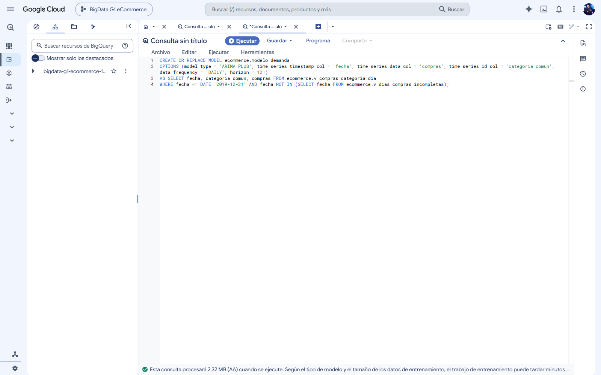
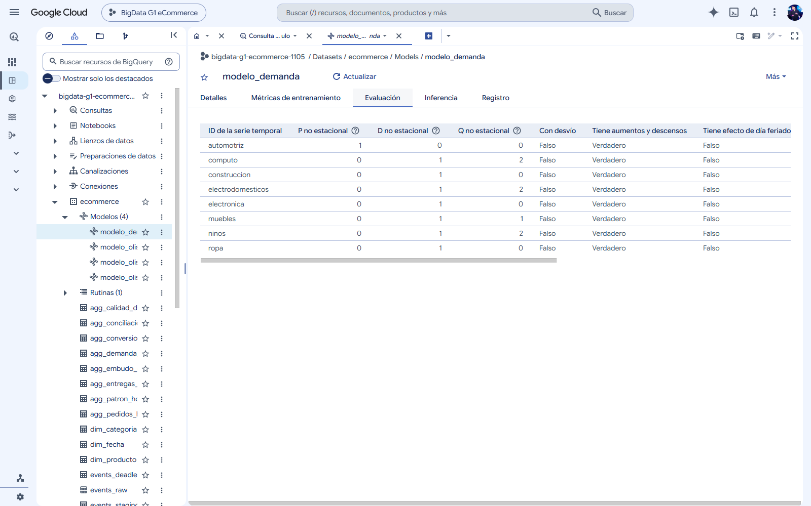
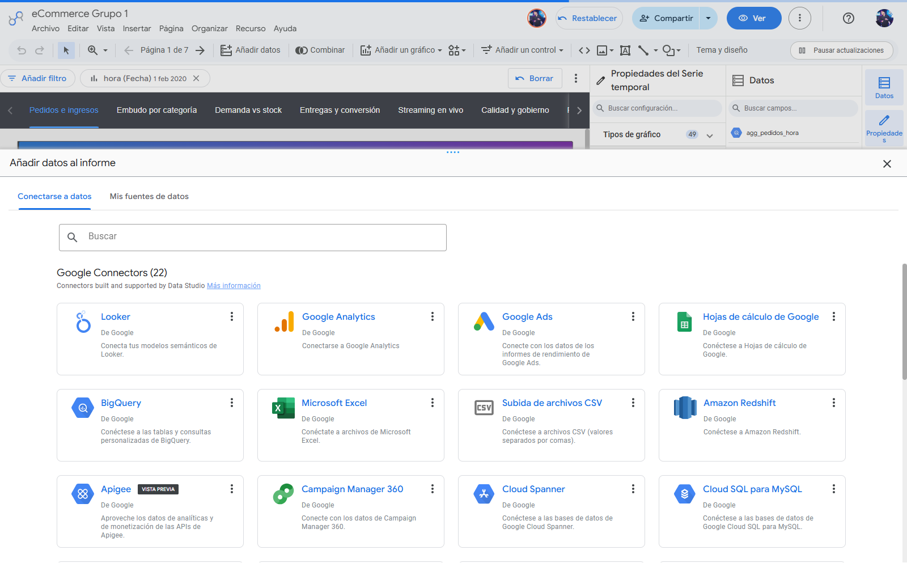
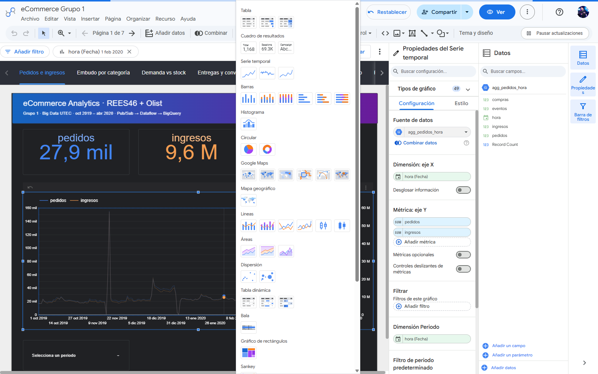
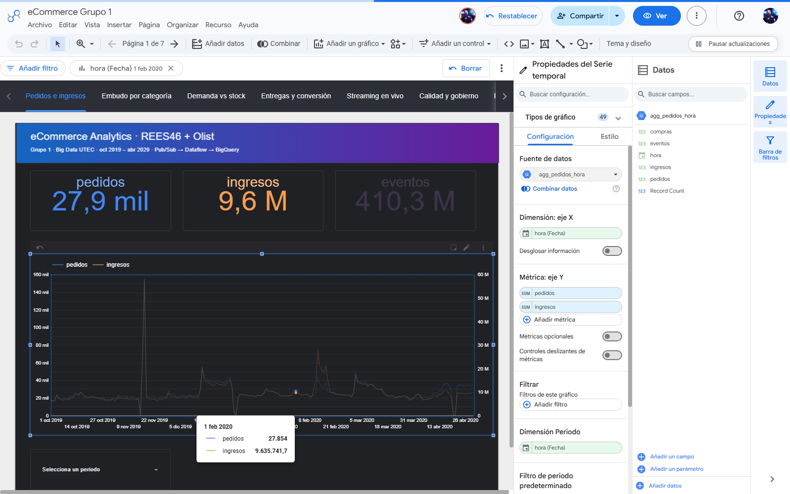
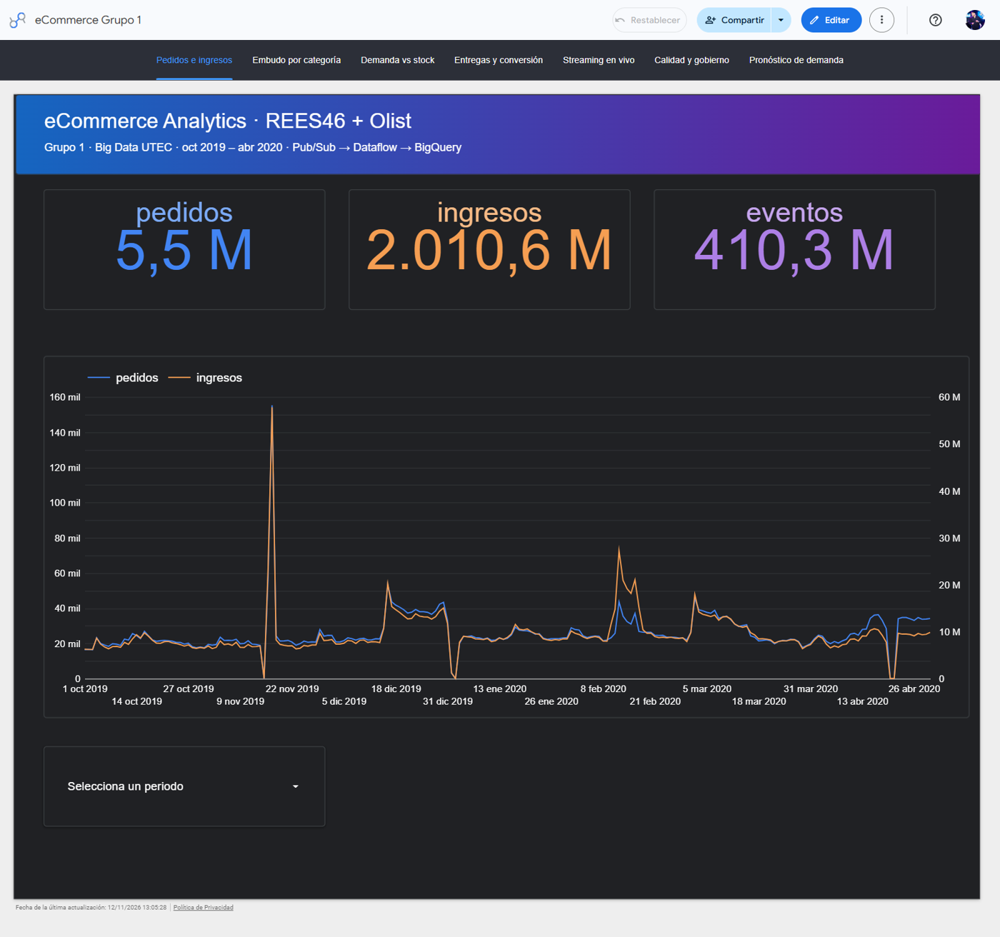
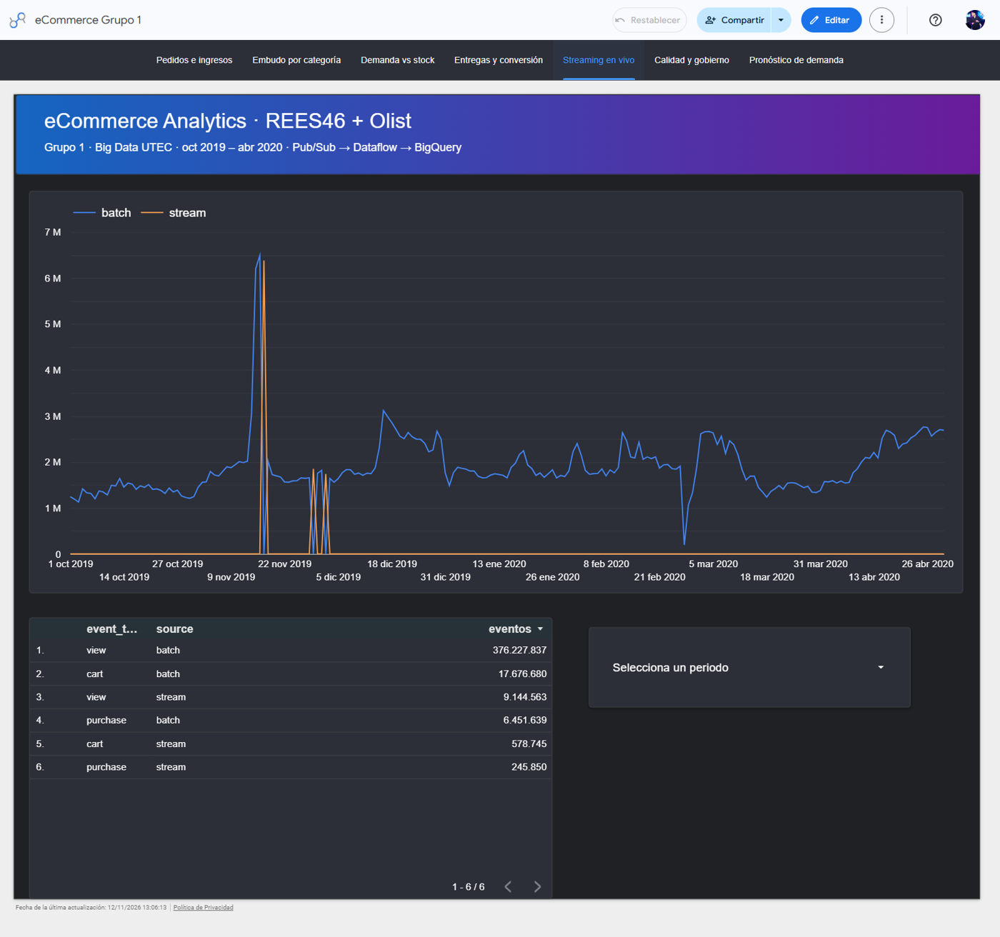
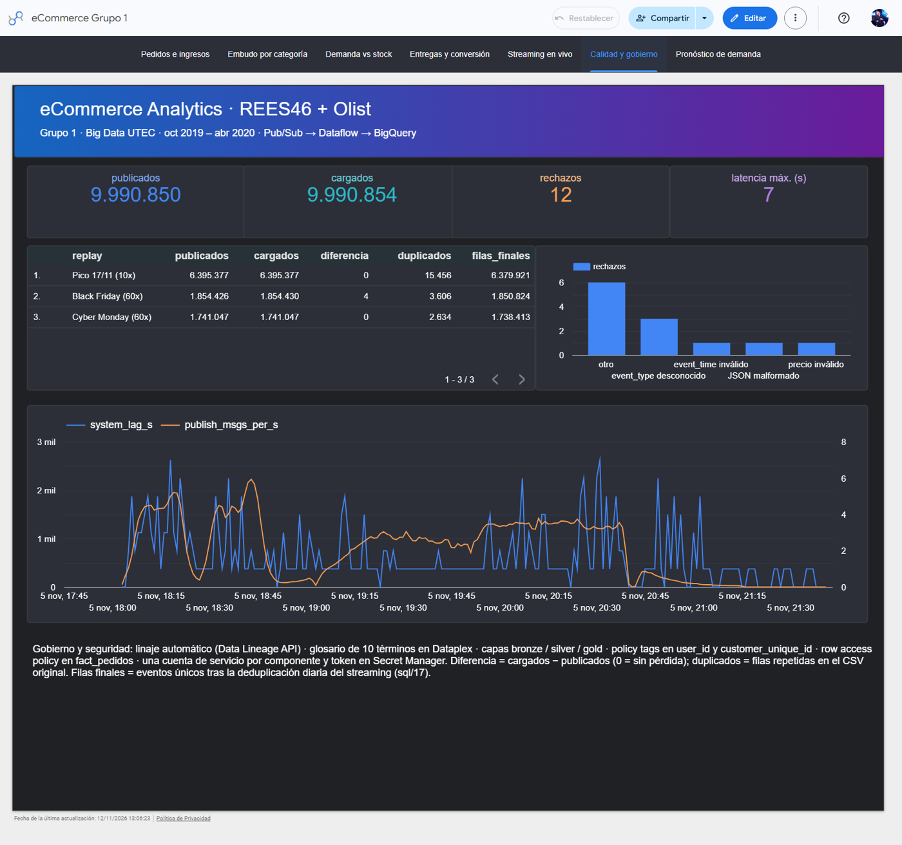
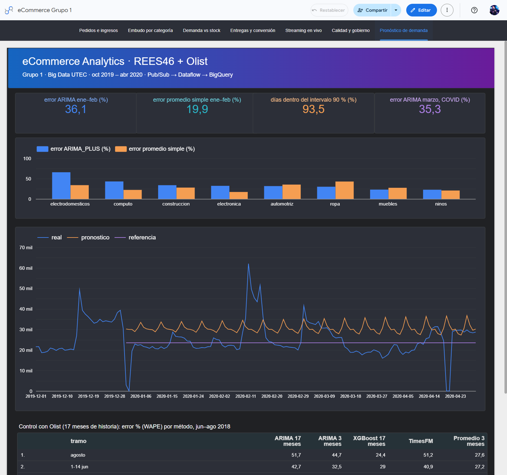

# 10. Pronóstico de demanda y tablero

## 10.1 Pronóstico con BigQuery ML (`sql/16_forecast.sql`)

```bash
sql/run.sh sql/16_forecast.sql
```

Pregunta: ¿se puede pronosticar la demanda diaria por categoría para dimensionar el stock? El script:

1. Crea la vista `v_dias_compras_incompletas`, que detecta los días en que el origen dejó de registrar compras
   (compras/eventos por debajo del 60 % de la mediana): 14–15 nov 2019, 1–2 ene y 20–21 abr 2020. Esos días se excluyen del
   entrenamiento y de la evaluación.
2. Entrena un modelo `ARIMA_PLUS` por cada categoría, con la serie diaria de compras de `agg_embudo_categoria_dia` (una
   tabla de KB, así que entrenar cuesta centavos) hasta el 31 de diciembre de 2019.
3. Pronostica 121 días con intervalo de 90 % y los compara con las compras reales de enero a abril de 2020, que el modelo
   nunca vio.
4. Compara cada error (WAPE) con una referencia ingenua: el promedio diario de oct–dic de cada categoría.

**En la consola.** Se abre el editor de BigQuery (**Consulta en SQL**) y se escribe el `CREATE MODEL`; antes de ejecutar,
el editor valida la consulta y avisa cuántos bytes procesará (aquí 2,32 MB). Se muestra la versión autocontenida, sin la variable
`fin_entrenamiento` del script, y no se ejecutó.



Cuando termina, el modelo aparece en el dataset y la pestaña **Evaluación** muestra los parámetros (p, d, q) que eligió ARIMA_PLUS para
cada categoría:



Resultado (WAPE, menor es mejor): con 3 meses de historia ARIMA **no supera** al promedio.

| Tramo | ARIMA_PLUS | Promedio simple |
|---|---|---|
| 1–14 ene | 44,5 % | 11,4 % |
| ene–feb | 36,1 % | 19,9 % |
| marzo | 35,3 % | 26,2 % |
| abril | 39,2 % | 21,3 % |

El intervalo de 90 % está bien calibrado: contiene el 93,5 % de los días de ene–feb.

## 10.2 Control con Olist (`sql/18_forecast_olist.sql`)

```bash
sql/run.sh sql/18_forecast_olist.sql
```

Olist tiene 17 meses de historia antes del corte. Se comparan cinco métodos sobre jun–ago 2018: ARIMA con 17 meses,
ARIMA con 3 meses, XGBoost (`BOOSTED_TREE_REGRESSOR` con variables de nivel y día de semana), TimesFM (modelo
preentrenado de Google, vía `AI.FORECAST`) y el promedio de 3 meses. Ninguno supera claramente al promedio; XGBoost es el
que más se acerca. La conclusión: **sin al menos dos años de datos ningún método aprende la estacionalidad anual**.

> **Costo.** El entrenamiento de XGBoost no corre en el motor de consultas y se factura con la tarifa de BigQuery ML:
> 50,8 GB. El ARIMA de REES46 facturó 21 MB. Antes de ejecutar un `CREATE MODEL` hay que estimar el gasto, porque
> `--dry_run` no funciona con ARIMA.

## 10.3 Tablero en Looker Studio

El tablero lee **solo tablas gold** (`agg_*`, `ml_*`, `mv_eventos_hora`, `stream_categoria_minuto`); nunca consulta
`events_raw`.

Pasos para recrearlo:

1. Abre el archivo `docs/looker_crear_reporte.url` (usa la *Linking API* de Looker Studio): crea un reporte nuevo con
   `agg_pedidos_hora` ya conectada.
2. Con **Añadir datos** → **BigQuery** conecta el resto de las fuentes del dataset `ecommerce`.


3. Construye las 7 páginas:

| Página | Fuente principal |
|---|---|
| 1. Pedidos e ingresos | `agg_pedidos_hora` |
| 2. Embudo por categoría | `agg_embudo_categoria_dia` |
| 3. Demanda vs stock | `agg_demanda_vs_inventario` |
| 4. Entregas y conversión | `agg_entregas_categoria`, `agg_conversion_vs_cumplimiento` |
| 5. Streaming en vivo | `stream_categoria_minuto`, `mv_eventos_hora` |
| 6. Calidad y gobierno | tablas de `sql/13_quality_dashboard.sql` |
| 7. Pronóstico de demanda | `ml_pronostico_*`, `ml_resumen_*`, `ml_eval_*` |

Cada gráfico se arma con **Añadir un gráfico** (aquí una serie temporal) y se configura en el panel de la derecha: fuente de datos
(`agg_pedidos_hora`), dimensión del eje X (`hora`) y métricas (`SUM pedidos`, `SUM ingresos`).





Así se ven las páginas principales. La 1 resume pedidos, ingresos y eventos con su serie diaria; la 5 compara el flujo por
lotes con el de streaming; la 6 muestra la reconciliación de los replays y las alertas; la 7 compara el pronóstico con lo real.









4. Looker guarda los datos en caché durante 12 horas: antes de presentar usa ⋮ → **Actualizar datos**, y tras cambiar un
   esquema, **Actualizar campos** en la fuente.

Reporte (acceso restringido al equipo):
<https://lookerstudio.google.com/reporting/270afb19-8307-4db9-b5a8-4465d24330ee>
