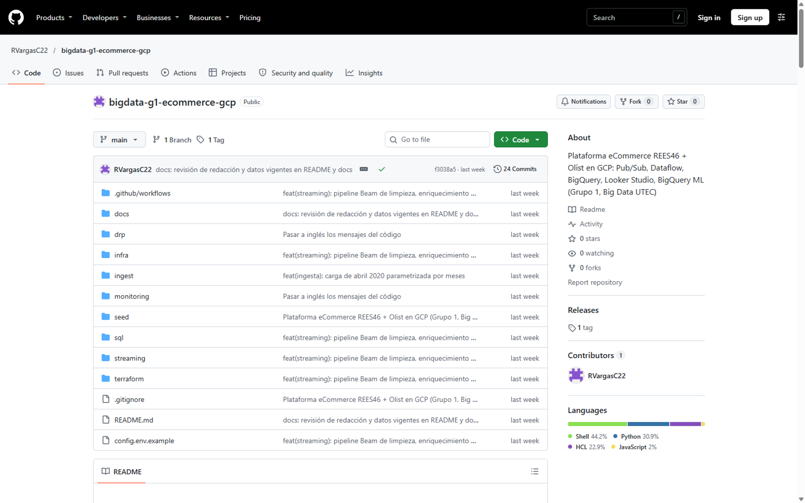

# Tutorial: cómo montar la plataforma paso a paso

Esta guía permite que otra persona reproduzca la plataforma completa en su propio proyecto de Google Cloud.
Cada capítulo explica qué se crea, por qué, qué comandos se ejecutan, qué código interviene y qué se debe ver en
la consola al terminar. Las capturas de pantalla se tomaron el 12 de noviembre de 2026 sobre el proyecto real
(`bigdata-g1-ecommerce-1105`), relanzando para ello la VM y los dos jobs de Dataflow.

Repositorio: <https://github.com/RVargasC22/bigdata-g1-ecommerce-gcp>

## Orden de lectura

| Capítulo | Qué se construye | Scripts y código principal |
|---|---|---|
| [1. Proyecto y configuración](01_proyecto_y_configuracion.md) | Proyecto, APIs, herramientas y `config.env` | `config.env.example` |
| [2. Almacenamiento, mensajería y warehouse](02_almacenamiento_pubsub_bigquery.md) | Bucket, datasets, tópico y suscripciones de Pub/Sub | `infra/01_setup.sh`, `infra/lifecycle.json`, `sql/01_ddl.sql` |
| [3. Identidades y secretos](03_identidades_y_secretos.md) | Cuentas de servicio y Secret Manager | `infra/02_iam.sh` |
| [4. Ingesta batch](04_ingesta_batch.md) | VM efímera, descarga a Cloud Storage y carga a BigQuery | `infra/03_vm.sh`, `ingest/*.sh`, `sql/02_load_events.sql` |
| [5. Streaming con la plantilla de Dataflow](05_streaming_plantilla_dataflow.md) | Pub/Sub → Dataflow → BigQuery con UDF y cola de errores | `streaming/udf/transform.js`, `streaming/launch_dataflow.sh`, `streaming/producer.py` |
| [6. Streaming con un pipeline Beam propio](06_streaming_beam.md) | Validación, enriquecimiento y agregación por minuto | `streaming/beam/pipeline.py`, `sql/19_stream_aggregates.sql` |
| [7. Modelo analítico](07_modelo_analitico.md) | Capas bronze, silver y gold | `sql/02` a `sql/06`, `sql/14`, `sql/17` |
| [8. Gobierno y acceso fino](08_gobierno_y_acceso.md) | Glosario, linaje, policy tags, row access | `infra/04`, `infra/05`, `sql/11`, `sql/12` |
| [9. Operación y recuperación](09_operacion_y_recuperacion.md) | Consultas programadas, alertas, snapshots, simulacro | `infra/06`, `monitoring/`, `drp/` |
| [10. Pronóstico y tablero](10_pronostico_y_tablero.md) | BigQuery ML y Looker Studio | `sql/16`, `sql/18`, `docs/looker_crear_reporte.url` |
| [11. Costos y apagado](11_costos_y_apagado.md) | Cuánto cuesta y cómo apagar todo | `infra/99_teardown.sh` |

## Requisitos previos

- Una cuenta de Google con permiso para crear un proyecto y una cuenta de facturación activa (con créditos o con tarjeta).
- `gcloud` y `bq` (Google Cloud SDK), Python 3, `git` y Terraform 1.7 o superior.
- Para el pipeline Beam, Python 3.12 con `apache-beam[gcp]==2.66.0` (Dataflow todavía no ejecuta 3.14).
- Una cuenta de Kaggle y su token de API, solo para descargar los datos de REES46 y Olist.
- Unos 2 USD al mes de almacenamiento y, mientras corran, unos pocos dólares por hora de Dataflow y de la VM.

## Convenciones

- Los nombres de archivos y el código están en inglés; la documentación, en español.
- Los nombres desplegados de tablas, columnas, etiquetas y alertas están en español (por ejemplo `fact_pedidos` o
  `categoria_comun`), porque Looker Studio y las consultas dependen de ellos.
- Todos los scripts leen `config.env`, que no se versiona. Todo script SQL se ejecuta con `sql/run.sh`, que aplica un
  tope de bytes facturados y reemplaza las cuentas personales.
- Los scripts son idempotentes: se pueden volver a ejecutar sin duplicar recursos.

## Qué se ve en la consola y qué no

Las capturas muestran la consola de Google Cloud en español. Cuando un recurso es efímero (la VM y los jobs de
Dataflow), la captura se tomó mientras existía y el capítulo indica cómo apagarlo. Los gráficos de métricas de
Dataflow se capturaron con el job ya drenado; las métricas del pico completo están en
`monitoring/export_metrics.py` y en `docs/evidencia/metricas_pico.csv`.
